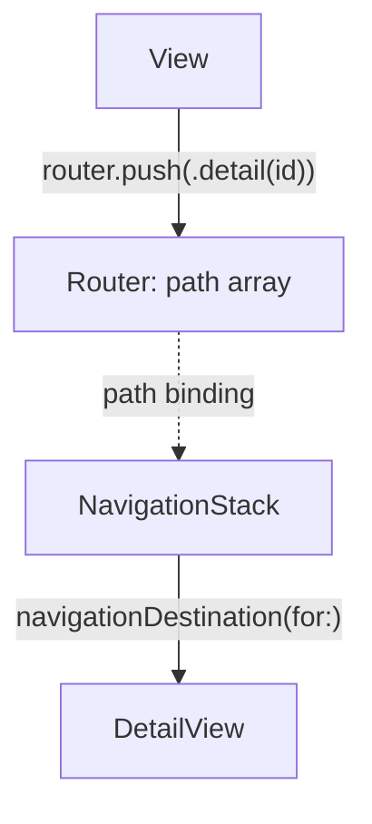

#SwiftUI #Navigation

**Navigation as state** (Router pattern). With `NavigationStack(path:)`, navigation is just data: an array of routes. A router object owns that path. Replaces UIKit coordinators (see [[MVP-C]]).

```swift
enum Route: Hashable { case detail(id: Int), settings }

@Observable final class Router {
    var path: [Route] = []
    func push(_ route: Route) { path.append(route) }
    func popToRoot() { path.removeAll() }
}

struct RootView: View {
    @State private var router = Router()
    var body: some View {
        NavigationStack(path: $router.path) {
            HomeView()
                .navigationDestination(for: Route.self) { route in
                    switch route {
                    case .detail(let id): DetailView(id: id)
                    case .settings: SettingsView()
                    }
                }
        }
        .environment(router)
    }
}
```

**Pros**:
- deep links and state restoration: just set the path array
- navigation testable without UI
- screens don't know about each other

**Cons**:
- sheets, alerts and tabs need extra handling
- the router has to know every route
- across feature modules, routes need a shared definition (see [[Modularization]])


