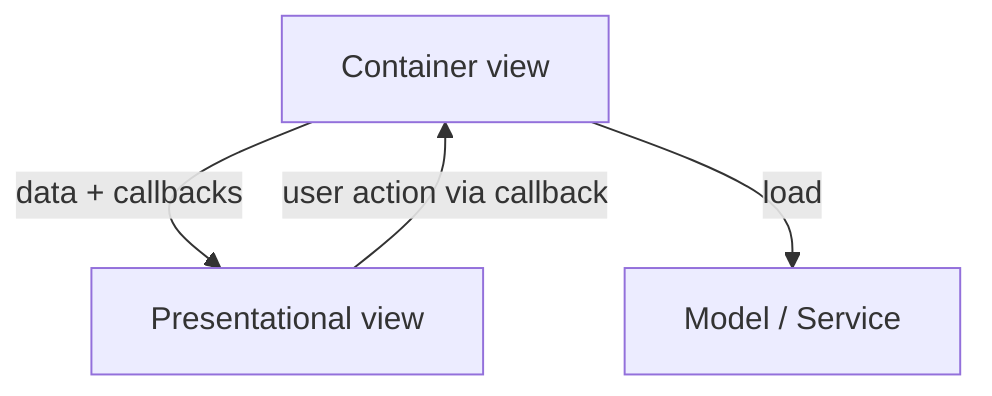

#SwiftUI

Instead of large views: many small ones.
- **Small views**: extract subviews, each with one job
- **ViewModifiers**: reusable styling and behavior (`.cardStyle()`)
- **Container / presentational split**:
	- *container view*: loads data, owns state, knows the data sources
	- *presentational view*: only displays the data it gets, no dependencies

```swift
struct OrdersScreen: View {                    // container
    @State private var model = OrdersModel()
    var body: some View {
        OrderList(orders: model.orders, onSelect: model.select)
            .task { await model.load() }
    }
}

struct OrderList: View {                       // presentational
    let orders: [Order]
    let onSelect: (Order) -> Void
    var body: some View { /* ... */ }
}
```

**Pros**:
- presentational views are easy to preview, reuse and test
- only containers depend on data sources
- smaller views also help SwiftUI performance (less re-rendering)

**Cons**:
- more types and passing of values / closures
- splitting too fine makes code hard to follow


