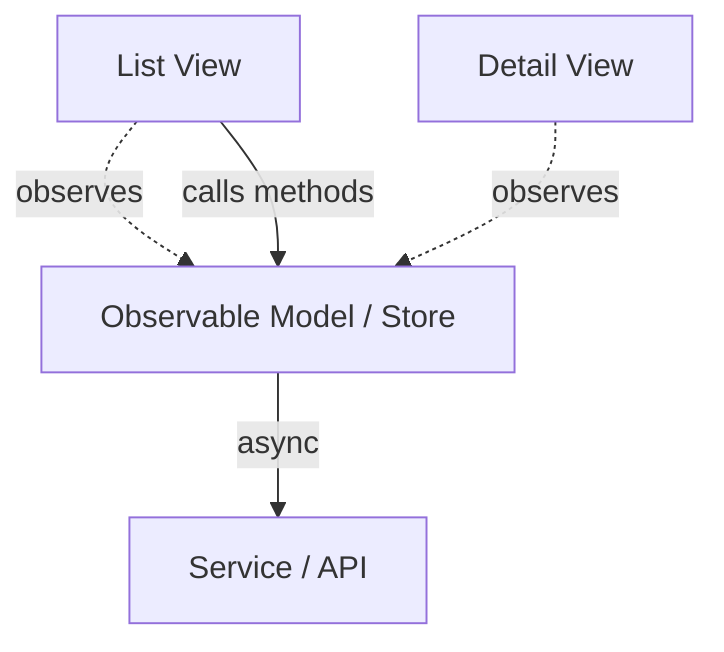

#Architecture #UIArchitecture #SwiftUI

**M**odel–**V**iew, "Apple style" in SwiftUI. No ViewModel per screen:
- **M**odel: `@Observable` models or stores holding data and logic, often shared via `@Environment`
- **V**iew: SwiftUI views observe the models directly and call their methods
- the idea: SwiftUI views already update automatically from state, so a ViewModel per screen is often redundant
- most of Apple's own sample code works this way

**Pros**:
- very little code
- uses SwiftUI the way it was designed
- no duplicated state between ViewModel and model

**Cons**:
- logic can end up in the views
- harder to test when views do too much
- controversial, much debated in the community (vs. [[MVVM]])

