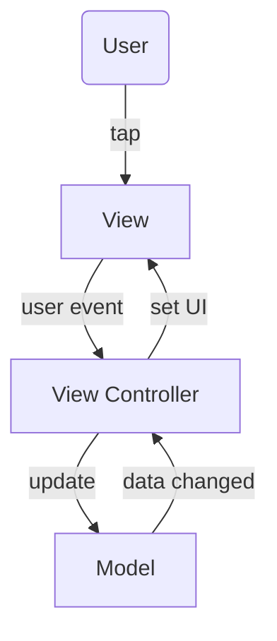

#Architecture #UIArchitecture #UIKit

Apple's classic pattern in UIKit:
- **M**odel: the data and business rules
- **V**iew: the UI elements
- **C**ontroller: the `UIViewController`. It connects the two, reacts to user input and updates the view
- on iOS the View and Controller are tightly coupled, because the view controller also manages the view's lifecycle

**Pros**:
- simple and fast to start
- no extra abstraction
- it's what Apple's UIKit documentation uses

**Cons**:
- the view controller tends to accumulate logic, networking, navigation and formatting: "Massive View Controller"
- hard to unit-test because the logic is tied to UIKit
- navigation has no clear home (see [[MVP-C]])
- not a natural fit for SwiftUI, which has no view controllers (see [[MVVM]], [[MV]])

