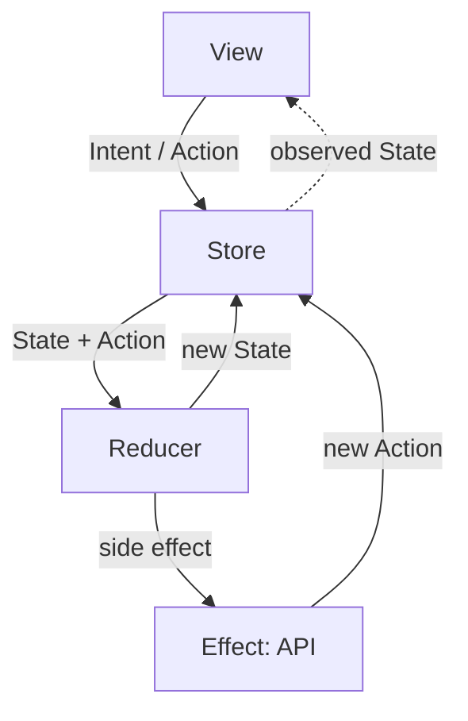

#Architecture #UIArchitecture #UnidirectionalDataFlow

Unidirectional data flow (UDF). Called **MVI** (Model–View–Intent) on Android, **Redux** on the web:
- **State**: a single, immutable description of what the screen (or app) shows
- **Intent / Action**: what the user (or the system) wants to happen
- **Reducer**: a pure function `(State, Action) -> new State`
- **Store**: holds the state, receives actions, runs the reducer
- side effects (API calls) run outside the reducer and send new actions back

The same idea across platforms: React/Redux, Android MVI, [[TCA]] on iOS, Compose Multiplatform apps.

**Pros**:
- predictable: the state only changes in one place
- easy to debug (log every action, replay state)
- very testable, the reducer is a pure function
- fits declarative UI (SwiftUI, Compose, React)

**Cons**:
- boilerplate: actions and reducer for every interaction
- a single big state can get complex and slow to update
- side effects need an extra concept (middleware, effects)

