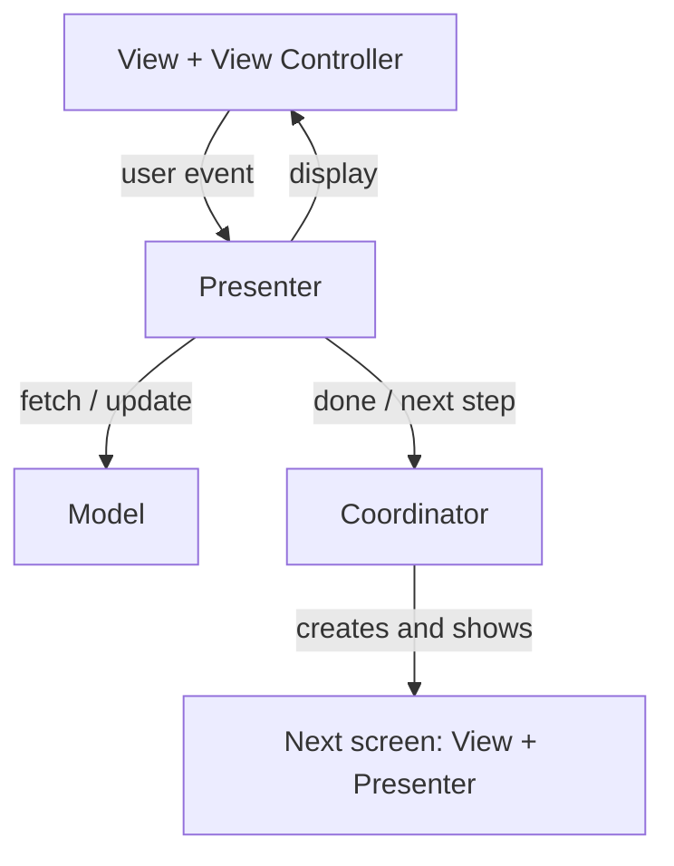

#Architecture #UIArchitecture #Navigation #UIKit

[[MVP]] plus **C**oordinators:
- **Coordinator**: an object responsible only for navigation and screen flow. Creates the screens, wires up their dependencies and decides which screen comes next
- Model, View and Presenter as in [[MVP]]
- Coordinators can also be combined with [[MVC]] or [[MVVM]]

**Pros**:
- screens don't know about each other, so they're reusable and can be reordered
- flows (onboarding, checkout) are defined in one place
- helps with deep links

**Cons**:
- even more structure
- coordinator hierarchies (child coordinators, memory management) can be fiddly
- the system back button and swipe-to-dismiss need extra handling

