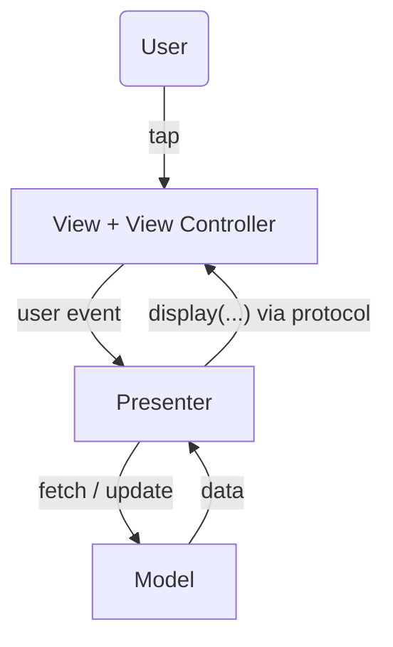

#Architecture #UIArchitecture #UIKit

Moves the logic out of the view controller into a presenter:
- **M**odel: the data and business rules
- **V**iew: the UI elements **and** the `UIViewController`. Passive, only displays what it's told
- **P**resenter: the presentation logic. Knows the view only through a protocol and tells it exactly what to show

**Pros**:
- the presenter has no UIKit dependency, easy to unit-test with a mock view
- clear separation of responsibilities

**Cons**:
- more code: a protocol for every view
- the presenter has to push every change to the view manually
- navigation still has no clear home (see [[MVP-C]])

