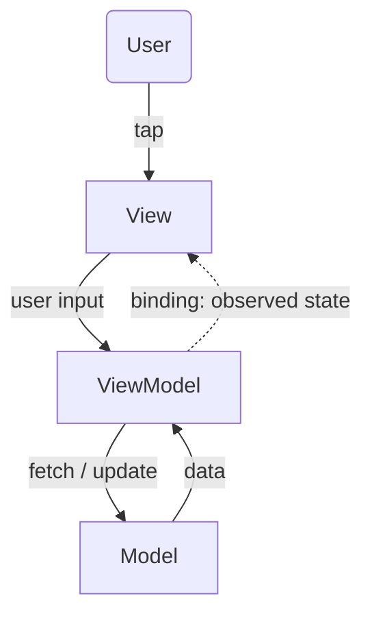

#Architecture #UIArchitecture #SwiftUI #UIKit

The view **binds** to the ViewModel and updates itself automatically:
- **M**odel: the data and business rules
- **V**iew: the UI elements, observes the ViewModel
- **V**iew**M**odel: turns model data into ready-to-display state. Doesn't know the view at all
- binding via Combine, RxSwift, closures, or `@Observable` / `ObservableObject` in SwiftUI

**Pros**:
- the ViewModel is UIKit-free and easy to test
- fits SwiftUI naturally, today's default for SwiftUI apps (`@Observable` since iOS 17, no Combine needed)

**Cons**:
- clumsy in UIKit without a binding framework
- ViewModels can grow into "Massive ViewModels"
- reactive bindings can be hard to debug
- navigation not covered, often combined with coordinators (see [[MVP-C]])
- in SwiftUI, ViewModels often just pass data through (see [[MV]])

