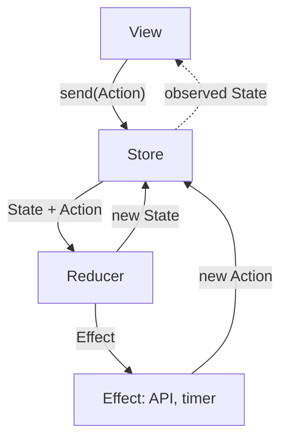

#Architecture #UIArchitecture #SwiftUI #UnidirectionalDataFlow

**The Composable Architecture** by Point-Free. A Swift library implementing [[MVI (Redux)]]:
- **State**: the feature's data
- **Action**: everything that can happen (user input, responses)
- **Reducer**: turns state and action into new state
- **Effect**: explicit side effects (network calls, timers) that send new actions back
- **Store**: runs the feature, the view observes it
- dependencies via `@Dependency`
- features can be combined (composed) into larger ones

**Pros**:
- predictable, one-way data flow
- very good testability, including side effects (`TestStore`)
- fits SwiftUI well

**Cons**:
- dependency on a third-party library with frequent API changes
- steep learning curve
- can affect compile times and performance in large state trees

