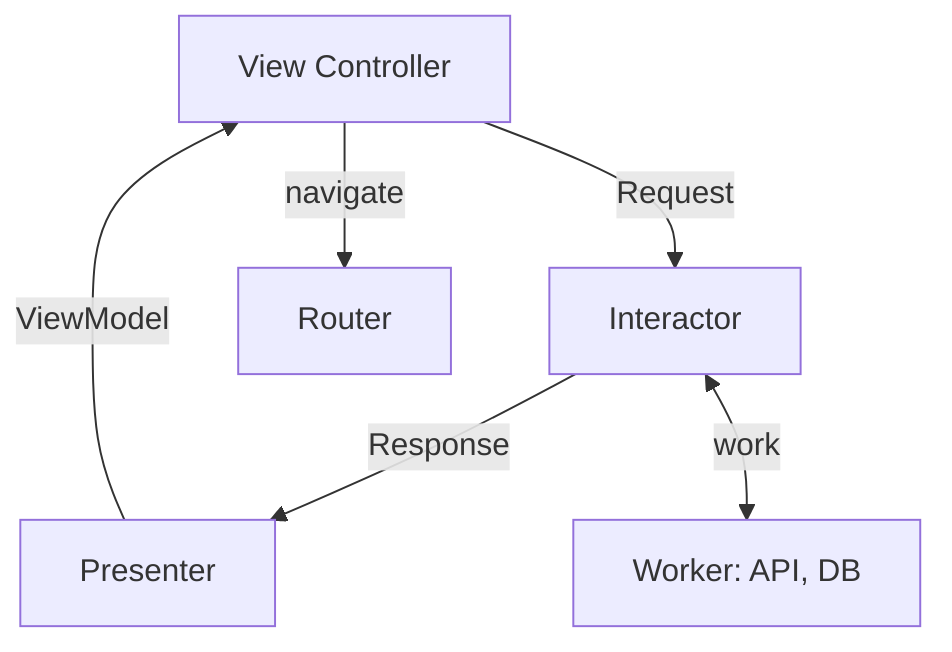

#Architecture #UIArchitecture #UIKit

Also known as **Clean Swift**. Similar parts to [[VIPER]], but the data flows **one way in a cycle**:
- **V**iew Controller: sends a *Request* to the interactor
- **I**nteractor: runs the business logic (with Workers for API, DB), passes a *Response* to the presenter
- **P**resenter: formats it, passes a *ViewModel* back to the view controller
- Router: navigation, passes data on to the next screen

**Pros**:
- the one-way flow is easy to follow and debug
- each step is testable on its own
- no back-and-forth calls as in [[VIPER]]

**Cons**:
- lots of boilerplate and many types per screen, usually needs templates
- oversized for simple screens

