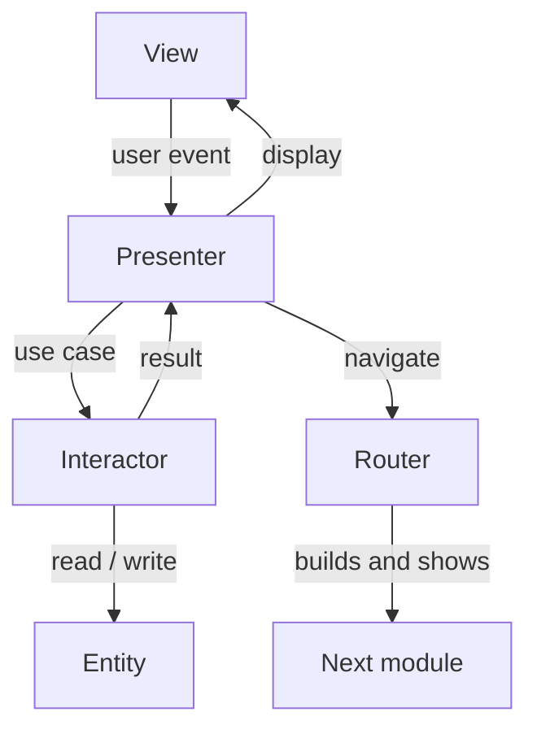

#Architecture #UIArchitecture #UIKit

Strict split of each screen into five parts, all connected through protocols:
- **V**iew: displays and forwards user input
- **I**nteractor: business logic and use cases
- **P**resenter: formats data for the view, coordinates the other parts (the hub)
- **E**ntity: plain data models
- **R**outer: navigation and assembling the screen (module)

**Pros**:
- very clear responsibilities
- high testability
- works well for large teams and codebases, people can work on separate parts without conflicts

**Cons**:
- lots of boilerplate: about five files and several protocols even for a simple screen, usually needs code generators
- steep learning curve
- over-engineered for small apps
- poor fit for SwiftUI

