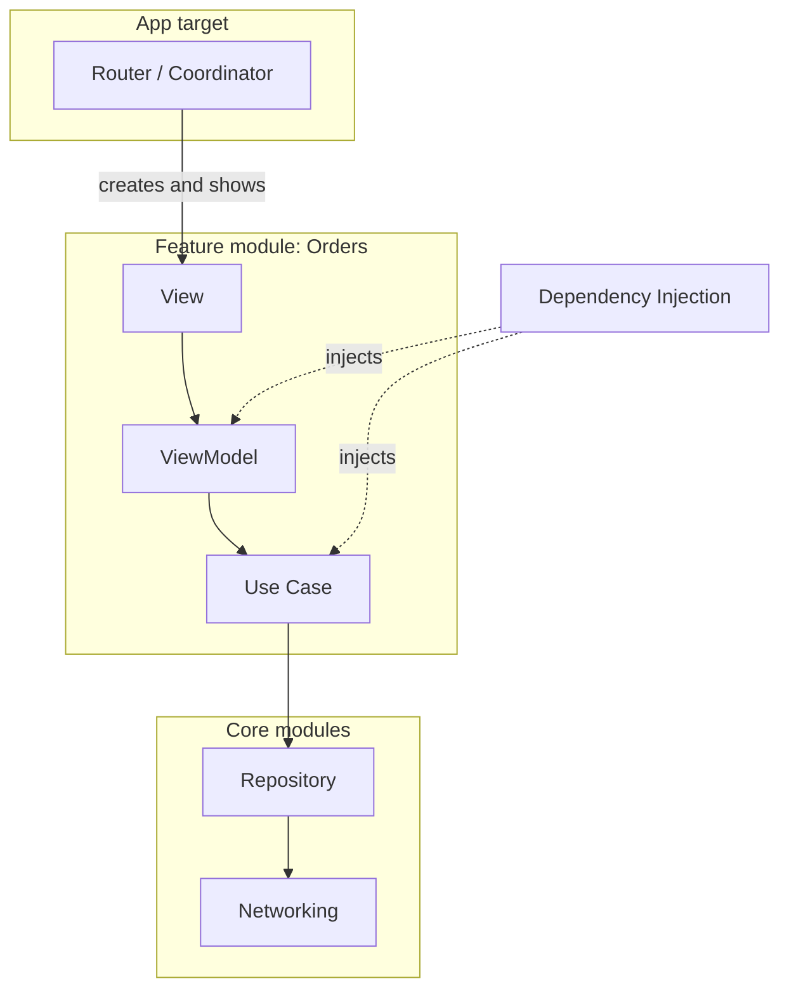

#Architecture #iOS

How the levels fit together. Each level answers a different question:

| Level | Question | Options |
|---|---|---|
| App architecture | How is the app layered and split? | [[Clean Architecture]], [[Modularization]], [[RIBs]] |
| UI architecture | How is a single screen structured? | [[MVC]], [[MVP]], [[MVVM]], [[VIPER]], [[VIP]], [[MVI (Redux)]], [[TCA]], [[MV]] |
| Navigation | Who decides which screen comes next? | Coordinator ([[MVP-C]]), Router ([[VIPER]], [[SwiftUI Navigation]]), state ([[TCA]]) |
| State | Who owns the data a view shows? | [[State Management]] |
| Wiring | How do objects get their dependencies? | [[Dependency Injection]] |

They combine: a UI architecture pattern lives in the presentation layer of the app architecture, inside a feature module.

## Typical modern setup (SwiftUI)
- **Screens**: [[MVVM]] with `@Observable`, or [[MV]] for simple screens
- **Navigation**: state-based with a router ([[SwiftUI Navigation]])
- **App structure**: [[Clean Architecture]] layers only where there's real business logic
- **Code organization**: feature modules with SPM ([[Modularization]])
- **Wiring**: initializer injection, `@Environment` for shared things ([[Dependency Injection]])
- **More structure**: [[TCA]] if the team wants strict unidirectional data flow and testable side effects

## Two families of UI patterns
- **View is told what to do**: [[MVC]], [[MVP]], [[VIPER]]. Controller or presenter calls the view. Mostly UIKit
- **View observes state**: [[MVVM]], [[VIP]], [[MVI (Redux)]], [[TCA]], [[MV]]. One-way data flow, fits SwiftUI

## How to choose
- team size and experience
- how long the app will live
- UI framework (UIKit or SwiftUI)
- simple first, more structure only when it pays off
- apply one approach consistently, don't mix several in the same codebase
