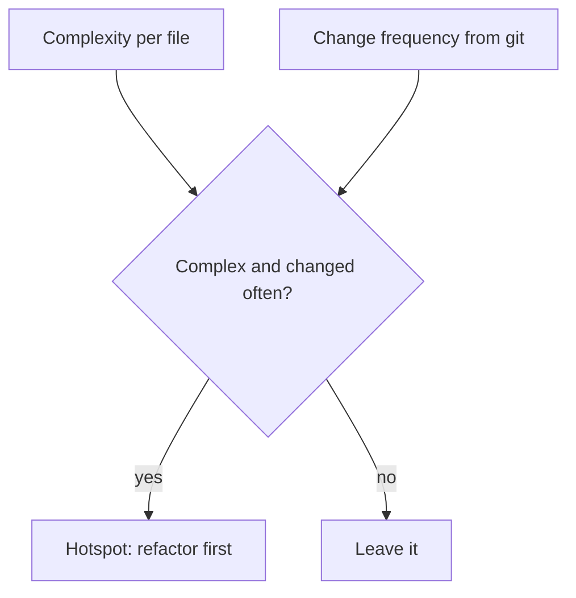

#SoftwareEngineering #CodeQuality

Good code is code that's **cheap to change correctly**. Quality attributes that matter day to day:
- **Readability**: someone else understands it quickly
- **Maintainability**: changes stay local and safe
- **Testability**: behavior can be checked in isolation
- **Reliability**: it does what it should, also in edge cases
- ISO/IEC 25010 defines the full model (also performance, security, usability, portability, ...)

## Measuring quality
Metrics make parts of quality visible:
- [[Size Metrics]]: how big (LOC, methods per class)
- [[Complexity Metrics]]: how hard to understand and test (cyclomatic, cognitive complexity)
- [[Coupling and Cohesion Metrics]]: how entangled (Ca, Ce, instability, LCOM, ACD, cycles)
- [[Test Coverage]]: how much code tests execute (line, branch, mutation score)
- [[Static Analysis and Quality Gates]]: automated checks and pass / fail rules in CI

Metrics **point to hotspots**, they don't judge code by themselves. A complex method can be fine (a parser), a simple one can be wrong. Combine numbers with code review.

**Goodhart's law**: "When a measure becomes a target, it ceases to be a good measure." Coverage targets produce tests without assertions, line limits produce cramped code. Watch **trends** (is it getting worse?) and **outliers** (the worst 5 % of files), not absolute numbers.

## Hotspots
Not all bad code matters. Complex code that nobody touches costs nothing. **Hotspots** = high complexity × high change frequency (git churn), from Adam Tornhill's *Your Code as a Crime Scene*. Refactor those first.

## Process metrics
Code metrics say nothing about delivery. For that, the **DORA metrics**: deployment frequency, lead time for changes, change failure rate, time to restore service. Good code quality tends to improve them.

**Pros** of measuring:
- objective data for refactoring and tech debt discussions
- regressions caught early in CI
- trends show whether quality is improving

**Cons**:
- numbers get gamed when they become targets
- metrics miss what matters most: good names, right abstractions, correct behavior
- tool noise: too many warnings get ignored

Related: [[Refactoring]], [[Tests in CI]]. See [[Software Engineering Overview]].
