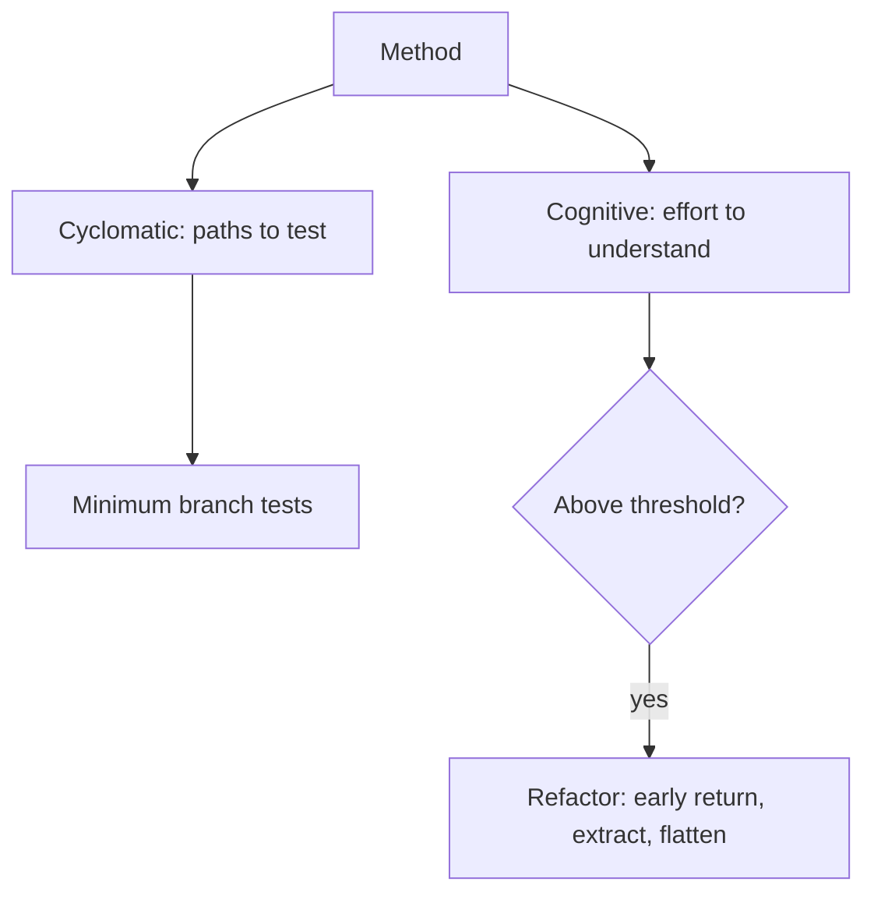

#SoftwareEngineering #CodeQuality #Metrics

How hard code is to **test** and to **understand**. Two metrics dominate.

## Cyclomatic complexity
Thomas McCabe, 1976. The number of linearly independent paths through a function:
- **decision points + 1**: each `if`, loop, `case`, `catch`, `&&`, `||`, `?:` adds one
- formally `M = E - N + 2P` on the control-flow graph (edges, nodes, connected parts)
- it's the **minimum number of tests** needed to cover every branch
- McCabe suggested a limit of 10. Common tool thresholds are 10-15 per method

## Cognitive complexity
SonarSource, 2017. How hard the code is to **understand** for a human:
- +1 for each break in linear flow (`if`, `else if`, `else`, loops, `catch`, a sequence of mixed `&&` / `||`, recursion)
- **+1 extra per nesting level**: nested code is penalized
- a `switch` / `when` counts **once**, however many cases it has
- shorthand that improves readability (early return, `?.`, `?:` null handling) is not penalized
- default threshold in SonarQube: 15 per method

The difference in practice:

```kotlin
// cyclomatic 7, cognitive 1: flat, easy to read
fun label(status: Status) = when (status) {
    Status.DRAFT -> "Draft"
    Status.PAID -> "Paid"
    Status.PACKED -> "Packed"
    Status.SHIPPED -> "Shipped"
    Status.DELIVERED -> "Delivered"
    Status.CANCELLED -> "Cancelled"
}

// cyclomatic 5, cognitive 10: fewer branches, but deeply nested
fun bulkyItemCount(orders: List<Order>): Int {
    var count = 0
    for (order in orders) {                 // cognitive +1
        if (order.isPaid) {                 // +2 (nesting 1)
            for (item in order.items) {     // +3 (nesting 2)
                if (item.isBulky) count++   // +4 (nesting 3)
            }
        }
    }
    return count
}
```

Cyclomatic complexity rates the flat `when` as harder (7 vs 5). Cognitive complexity rates the nested loops as much harder to read (10 vs 1). Fix the nested one with early returns, extracted functions, or collection operations (`orders.filter { it.isPaid }.flatMap { it.items }.count { it.isBulky }`).

## Other complexity measures
- **Nesting depth**: maximum indentation level. More than 3-4 is hard to follow ([[Object Calisthenics]] allows one)
- **Halstead metrics**: based on counts of operators and operands (volume, difficulty, effort). Mostly of historical interest
- **Maintainability Index**: combines Halstead volume, cyclomatic complexity and LOC into one score (Visual Studio shows 0-100). Coarse and dated, don't steer by it

**Pros**:
- point to the methods most likely to contain bugs and hardest to test
- cyclomatic complexity gives a lower bound for branch tests
- cognitive complexity matches developers' intuition well

**Cons**:
- per method only: a class of 50 trivial methods looks fine
- some code is inherently complex (parsers, state machines, business rules), the number alone doesn't mean it's bad
- encourages splitting into many tiny functions, which can hurt readability ([[KISS]])



Related: [[Refactoring]], [[Size Metrics]].

## In our stacks
- **iOS**: SwiftLint `cyclomatic_complexity` and `closure_body_length`, SonarQube for cognitive complexity
- **Spring Boot**: SonarQube (cognitive complexity rule), PMD `CyclomaticComplexity` and `CognitiveComplexity`, Checkstyle `CyclomaticComplexity`, `NestedIfDepth`
- **React Native**: ESLint `complexity` and `max-depth`, eslint-plugin-sonarjs `cognitive-complexity`
- **Compose Multiplatform**: detekt `CyclomaticComplexMethod`, `CognitiveComplexMethod`, `NestedBlockDepth`

See [[Code Quality]].
