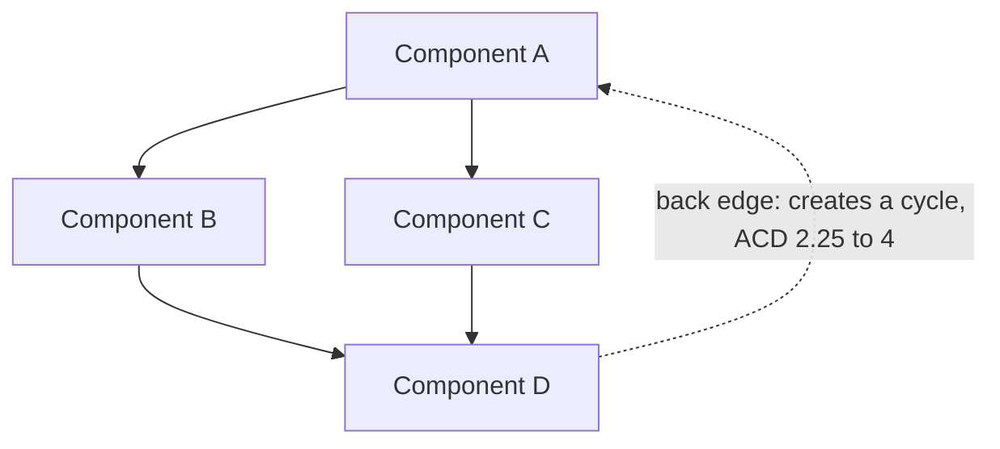

#SoftwareEngineering #CodeQuality #Metrics #Architecture

How **entangled** the code is. Good structure has **low coupling** (units depend on few others) and **high cohesion** (what's inside a unit belongs together). These metrics measure the structure the architecture notes describe ([[Modularization]], [[Modular Monolith]], [[Feature Folders]], [[KMP Project Structure]]).

## Class level
- **Afferent coupling (Ca, fan-in)**: how many others depend on this class. High = many callers break when it changes
- **Efferent coupling (Ce, fan-out)**: how many classes this one depends on. High = it breaks when any of them change, hard to test
- **CBO** (Coupling Between Objects, Chidamber & Kemerer): number of other classes a class is coupled to, in either direction. Above ~10-15 is a warning sign
- **LCOM** (Lack of Cohesion of Methods): do the methods of a class work on the same fields? Several variants exist. **LCOM4** counts groups of methods connected through shared fields or calls: 1 = cohesive, 2 or more = the class is really several classes ([[SOLID]]: single responsibility)

## Package level (Robert C. Martin)
- **Instability** `I = Ce / (Ca + Ce)`: 0 = stable (many depend on it, it depends on nothing), 1 = unstable (depends on others, nobody depends on it)
- **Abstractness** `A` = abstract types (interfaces, abstract classes) / all types in the package
- **Distance from the main sequence** `D = |A + I - 1|`: 0 is ideal
	- **zone of pain** (A ≈ 0, I ≈ 0): concrete and heavily depended on, painful to change (e.g. a shared utils package full of concrete classes)
	- **zone of uselessness** (A ≈ 1, I ≈ 1): abstract and unused
- matching principles: **Acyclic Dependencies** (no cycles between packages), **Stable Dependencies** (depend in the direction of stability), **Stable Abstractions** (stable packages should be abstract). The domain in [[Hexagonal Architecture]] is stable and holds the interfaces

## Component dependency (John Lakos)
From *Large-Scale C++ Software Design*. Measures how far changes ripple through the whole dependency graph, including indirect dependencies:
- **DependsOn(c)**: the number of components `c` depends on directly or indirectly, **including itself**
- **CCD** (Cumulative Component Dependency): sum of DependsOn over all components. Also the cost to rebuild and retest every component once
- **ACD** (Average Component Dependency) = CCD / number of components: on average, how many components each component needs (and how many get affected by a change)
- **rACD** (relative ACD) = ACD / number of components, as a percentage. Comparable between systems of different size
- **NCCD** (Normalized CCD) = CCD / CCD of a balanced binary tree with the same number of components. Below 1 is flatter than a tree, well above 1 points to heavy layering or cycles

Example with four components:

| Structure | DependsOn per component | CCD | ACD |
|---|---|---|---|
| A uses B and C, both use D | A 4, B 2, C 2, D 1 | 9 | 2.25 |
| same, plus D uses A (a cycle) | A 4, B 4, C 4, D 4 | 16 | 4 |

One back edge makes every component depend on every other: a change anywhere can affect everything. Cycles are why ACD explodes in large codebases.

## Cycles
Cyclic dependencies between classes, packages or modules are the most important structural smell:
- the components in a cycle can only be understood, tested, built and released together
- they block splitting into modules or services
- fix: move the shared part into its own component, or invert one dependency with an interface (dependency inversion)

**Pros**:
- make architecture erosion visible over time
- show where changes will ripple and where tests are expensive
- cycle and dependency rules can be enforced automatically in CI ([[Static Analysis and Quality Gates]])

**Cons**:
- the numbers need interpretation: a shared kernel is supposed to have high Ca
- tool support varies a lot between languages
- class-level metrics are noisy, package and module level is usually more useful

## In our stacks
- **iOS**: Swift Package Manager forbids cycles between packages and targets, which enforces module boundaries ([[Modularization]]). `tuist graph` or SPM dependency graphs for visualizing, Periphery for unused code
- **Spring Boot**: ArchUnit (`slices().should().beFreeOfCycles()`), Spring Modulith verification, JDepend for Martin's package metrics, Sonargraph for CCD / ACD / NCCD, IntelliJ's dependency matrix
- **React Native**: dependency-cruiser (`no-circular`, custom layer rules), madge `--circular` for cycle detection
- **Compose Multiplatform**: Gradle forbids cycles between modules, Konsist tests for package rules, detekt for class-level issues

See [[Code Quality]].
