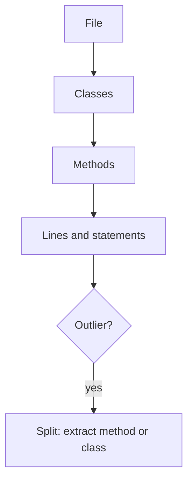

#SoftwareEngineering #CodeQuality #Metrics

The simplest metrics: how **big** is the code. Size alone says little, but very large units are almost always hard to understand, test and change.

Lines of code:
- **LOC** (physical lines): every line in the file, including blanks and comments
- **SLOC / NCLOC** (source / non-comment lines): without blanks and comments. The usual "lines of code" in tools
- **LLOC** (logical lines): number of statements. Independent of formatting

Other size measures:
- **lines per method / function**
- **lines per class / file**
- **methods per class**
- **parameters per method**: more than 3-4 hints at a missing parameter object
- **files per package / module**

Typical thresholds (tool defaults vary, treat as a warning, not a rule):

| Measure | Warning at around |
|---|---|
| Lines per method | 20-30 |
| Lines per class / file | 300-500 |
| Parameters per method | 4-5 |
| Methods per class | 20 |

[[Object Calisthenics]] pushes much further (classes up to 50 lines, packages up to 10 files) as an exercise.

What size says:
- bug count grows with size, but roughly: per-line defect rates vary strongly between teams and code types
- large methods and classes usually violate the single responsibility principle ([[SOLID]])
- **LOC is useless as a productivity measure**: more code is not more value, deleting code is often progress

**Pros**:
- trivial to measure, every tool supports it
- easy to understand and explain
- outliers (a 3,000-line class) are clear refactoring candidates

**Cons**:
- depends on language and formatting
- says nothing about difficulty: 50 lines of mapping are easier than 10 lines of nested logic ([[Complexity Metrics]])
- line limits get gamed by cramming code onto fewer lines

## In our stacks
- **iOS**: SwiftLint rules `function_body_length`, `type_body_length`, `file_length`, `function_parameter_count`
- **Spring Boot**: Checkstyle (`MethodLength`, `ParameterNumber`), PMD, SonarQube size measures
- **React Native**: ESLint `max-lines`, `max-lines-per-function`, `max-params`, `cloc` for counts
- **Compose Multiplatform**: detekt `LongMethod`, `LargeClass`, `LongParameterList` (composables often need higher limits for parameters)

See [[Code Quality]].
