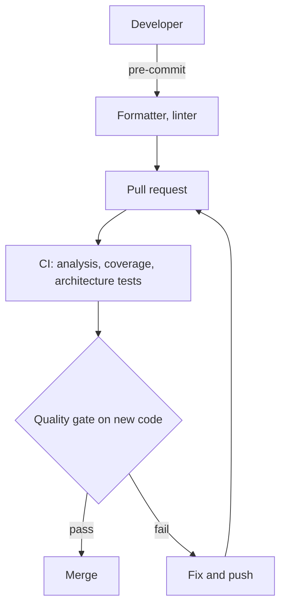

#SoftwareEngineering #CodeQuality #Metrics #CI

Analyze code **without running it**, automatically on every change. Quality gates turn the results into pass / fail rules in CI.

Kinds of tools:
- **Formatters**: one consistent layout, applied automatically. Ends style discussions in reviews
- **Linters**: style rules and common bug patterns (unused variables, missing `await`, force unwraps)
- **Type checkers and compiler warnings**: the cheapest static analysis there is. Treat warnings as errors
- **Static analysis platforms**: collect everything in one dashboard per project: bugs, code smells, security hotspots, [[Complexity Metrics]], duplication, [[Test Coverage]], technical debt
- **Security scanners**: vulnerable dependencies (SCA) and insecure code patterns (SAST) ([[Non-functional Tests]])
- **Architecture rules as tests**: allowed dependencies between layers and modules, no cycles ([[Coupling and Cohesion Metrics]], [[Hexagonal Architecture]])

Common platform measures:
- **duplication**: percentage of duplicated lines or blocks ([[DRY]]). Clone types range from exact copies (type 1) to similar code with changed names (type 2) and modified statements (type 3)
- **code smells**: maintainability issues ([[Refactoring]])
- **technical debt**: estimated time to fix all maintainability issues. **Technical debt ratio** = that time / estimated time to write the code. A rough but useful trend

## Quality gates
A set of conditions a change must meet before it can be merged. Best practice: apply them to **new code** only ("clean as you code"). Legacy code improves when it's touched, without blocking every pull request.

Example gate on new code:
- no new bugs or vulnerabilities of high severity
- coverage at least 80 %
- duplication at most 3 %
- all security hotspots reviewed
- no new architecture rule violations

Practices:
- run formatters and fast linters locally (pre-commit hook, IDE), the full analysis in CI
- start with few rules and a clean baseline, add rules gradually. Hundreds of ignored warnings teach the team to ignore all warnings
- suppressions in code need a reason
- the gate blocks merging. A dashboard nobody looks at changes nothing

**Pros**:
- catches whole classes of problems before review, reviewers focus on design
- consistent code across the team
- quality can't silently degrade

**Cons**:
- noisy rules and false positives cause frustration and blanket suppressions
- gates on legacy code block progress (hence "new code" gates)
- measures what's measurable, not what matters most (naming, design)

## In our stacks
- **iOS**: SwiftLint, SwiftFormat, Periphery (unused code), Xcode's static analyzer, SonarQube
- **Spring Boot**: SonarQube, Checkstyle, PMD, SpotBugs, Error Prone, OWASP Dependency-Check, ArchUnit or Spring Modulith for architecture rules ([[Modular Monolith]])
- **React Native**: ESLint with typescript-eslint, Prettier, `tsc --noEmit`, dependency-cruiser for architecture rules, `npm audit`, SonarQube
- **Compose Multiplatform**: detekt, ktlint, Android Lint, Konsist for architecture rules, SonarQube

See [[Code Quality]] and [[Tests in CI]].
