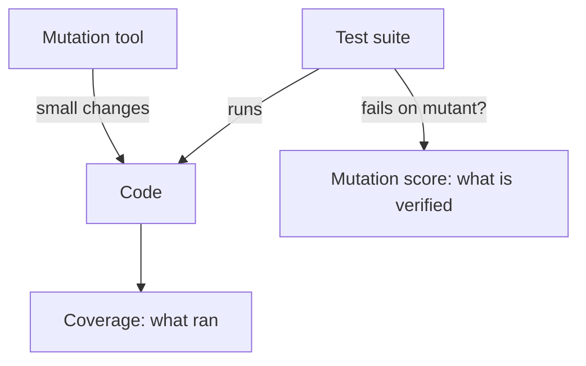

#SoftwareEngineering #CodeQuality #Metrics #Testing

The share of code **executed** by the test suite. Shows what's untested, not how well the rest is tested.

Kinds, from weak to strong:
- **Function coverage**: which functions were called at all
- **Line (statement) coverage**: which lines ran. The most common number, and the weakest useful one
- **Branch coverage**: whether each branch of every decision ran (both the `if` and the `else`). Catches untested error and edge paths that line coverage misses
- **Condition coverage**: whether each boolean sub-condition (`a`, `b` in `a && b`) was both true and false
- **MC/DC** (Modified Condition / Decision Coverage): each condition shown to independently affect the outcome. Required for safety-critical software (aviation, DO-178C)

```kotlin
fun discount(order: Order) = if (order.total > 100 && order.isMember) 10 else 0

// one test with total 150, member: 100 % line coverage, 50 % branch coverage
// the "else" path and the non-member case are never checked
```

## Limits
- coverage shows **execution**, not **verification**: a test without assertions still counts
- 100 % coverage doesn't mean correct: missing requirements have no code to cover
- as a target, it gets gamed ([[Code Quality]]: Goodhart's law) and leads to tests of trivial getters

## Mutation score
**Mutation testing** checks whether tests actually verify behavior: the tool makes small changes (**mutants**) to the code, e.g. `>` to `>=`, `&&` to `||`, removing a call, and runs the tests:
- a mutant is **killed** if some test fails
- a mutant **survives** if all tests still pass: a gap in the assertions
- **mutation score** = killed / total mutants
- slow on big codebases, run it on changed code or nightly ([[Tests in CI]])

## Practical targets
- measure coverage on **new and changed code** (diff coverage) in pull requests, e.g. at least 80 % on new code. Legacy code doesn't block every change
- treat **low** coverage as a signal (untested risk), never treat **high** coverage as proof
- prefer branch over line coverage
- exclude generated code, DTOs and framework glue from the measurement, so the number means something
- watch the trend per module, not a global number

**Pros**:
- shows untested code and forgotten paths
- cheap to collect in CI
- diff coverage keeps new code tested without big-bang targets

**Cons**:
- easy to game, says nothing about assertion quality
- a global percentage hides which parts are untested
- chasing the last percent costs more than it's worth



Related: [[Testing Best Practices]], [[Unit Tests]].

## In our stacks
- **iOS**: Xcode code coverage (enable in the test plan), `xcrun xccov` for reports, Slather for CI formats (Cobertura) and SonarQube. Muter for mutation testing
- **Spring Boot**: JaCoCo (line and branch coverage, `check` rules for minimum values), PIT for mutation testing, SonarQube for diff coverage on pull requests
- **React Native**: `jest --coverage` (Istanbul / V8, `coverageThreshold` in config), Stryker for mutation testing
- **Compose Multiplatform**: Kover (JVM and Android targets; Kotlin/Native coverage for iOS is limited), PIT on JVM-only modules

See [[Code Quality]].
