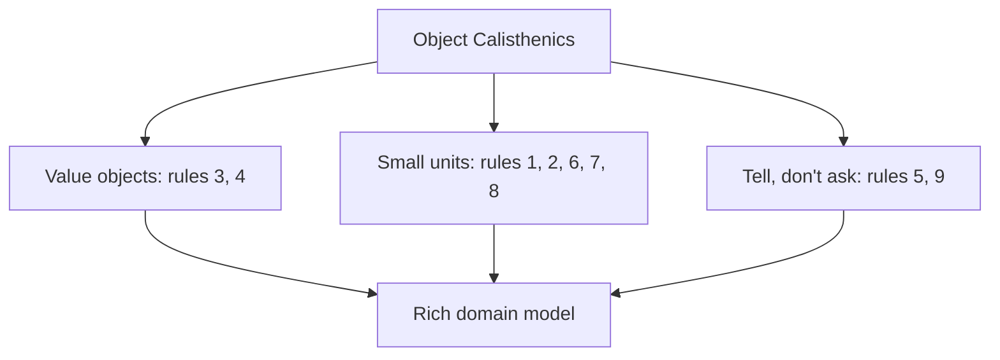

#SoftwareEngineering #BestPractices #ObjectOriented

Nine strict coding rules by Jeff Bay (*The ThoughtWorks Anthology*, 2008). Meant as an **exercise**: write a small project (a kata) following all nine, and you're forced into small objects with behavior, the design that [[SOLID]] and the [[Domain Model]] describe. In everyday code they're guidelines, not laws.

1. **Only one level of indentation per method**: extract the inner block into a method. Methods stay short and do one thing
2. **Don't use the `else` keyword**: return early, use guard clauses, or polymorphism instead of branching
3. **Wrap all primitives and strings**: `Email`, `Money`, `OrderId` instead of `String` and `Int`. Validation and behavior live in the type (value objects)
4. **First-class collections**: a class that contains a collection has no other fields. `Orders` instead of `List<Order>`, with the filtering and totals as its methods
5. **One dot per line**: `order.customer.address.city` reaches through other objects. Ask the direct collaborator instead (Law of Demeter)
6. **Don't abbreviate**: if a name is too long to write out, the class or method probably does too much
7. **Keep all entities small**: classes up to ~50 lines, packages up to ~10 files
8. **No classes with more than two instance variables**: forces splitting into smaller, cohesive objects
9. **No getters / setters / properties**: tell objects what to do instead of asking for their data and deciding outside ("Tell, don't ask")

```kotlin
// before: primitives, else, asking for data
fun ship(order: Order) {
    if (order.status == "PAID") {
        if (order.address != null) { /* ship */ } else { throw Error("no address") }
    } else { throw Error("not paid") }
}

// after: wrapped types, early return, tell don't ask
fun ship(order: Order) {
    order.ensureShippable()
    shipping.send(order.shipment())
}
```

Rules 3, 4 and 9 matter most in practice: value objects, first-class collections and behavior next to data. Rule 8 is the most extreme and rarely held to outside the exercise.

**Pros**:
- trains small, cohesive objects with clear responsibilities
- moves logic out of services into the domain (against anemic models)
- code becomes more testable and readable in small pieces

**Cons**:
- followed literally in production code: many tiny classes and indirection ([[KISS]])
- rule 9 clashes with frameworks that need getters (JPA, serialization, UI binding) and with data classes / records
- fits object-oriented domain code, less so UI code (SwiftUI, Compose, React) or functional styles



Related: [[Refactoring]], [[Domain Model]]. See [[Software Engineering Overview]].
