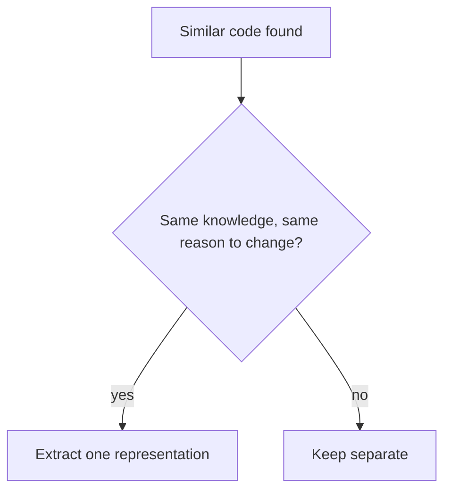

#SoftwareEngineering #BestPractices

**Don't Repeat Yourself** (Andy Hunt and Dave Thomas, *The Pragmatic Programmer*): "Every piece of knowledge must have a single, unambiguous, authoritative representation within a system."

DRY is about **knowledge**, not about lines of code:
- a business rule (VAT rate, password policy) defined in one place
- one source of truth for data ([[Server State vs Client State]], [[State Management]])
- schemas and types generated from one definition (OpenAPI, database migrations) instead of written twice

Two similar-looking pieces of code that change for **different reasons** are not duplication. Merging them couples things that should evolve separately.

Guidelines:
- **Rule of three**: tolerate the second copy, extract on the third, when the shared shape is clear
- **"Duplication is far cheaper than the wrong abstraction"** (Sandi Metz). If an abstraction grows parameters and flags for each caller, inline it again
- across services or modules, some duplication is the price of independence ([[Microservices]], [[Feature Folders]])

**Pros**:
- a rule changes in one place
- no inconsistencies between copies
- less code to maintain

**Cons**:
- premature abstraction couples unrelated code
- shared code across teams needs coordination
- over-DRY code is hard to read: indirection everywhere

The opposite of DRY is WET ("Write Everything Twice"). Related: [[KISS]]. See [[Software Engineering Overview]].
