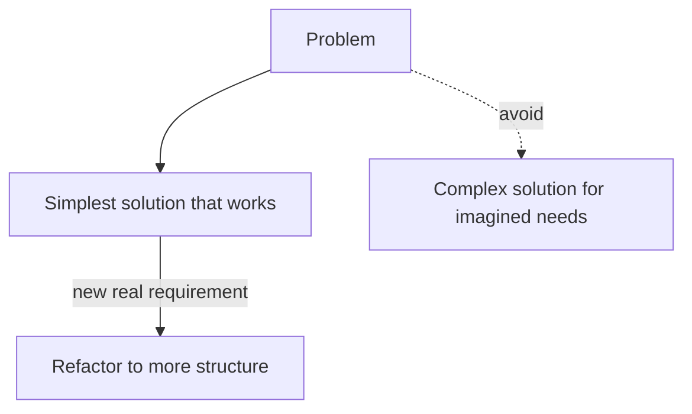

#SoftwareEngineering #BestPractices

**Keep It Simple, Stupid** (attributed to Kelly Johnson, Lockheed engineer). Most systems work best if they're kept simple. Prefer the simplest solution that solves the actual problem.

Simple means **easy to understand**, not "the fewest lines":
- plain code over clever code (no one-liners that need a comment to decode)
- the standard library and boring, well-known tools over custom frameworks
- few moving parts: fewer layers, services, abstractions and configuration
- straight-line code over generic, configurable code until a second real use case exists

```kotlin
// clever
fun isAdult(p: Person) = p.birthDate.plusYears(18).let { !it.isAfter(today()) }

// simple
fun isAdult(person: Person): Boolean {
    val eighteenthBirthday = person.birthDate.plusYears(18)
    return eighteenthBirthday <= today()
}
```

In architecture: start with the simplest structure that works ([[Layered Architecture]], [[MV]], one deployable) and add structure only when it pays off ([[Modular Monolith]] before [[Microservices]]).

**Pros**:
- easier to read, review, debug and onboard
- fewer bugs: less code, fewer states
- easier to change later, because nothing has to be unlearned

**Cons**:
- "simple" is subjective and depends on the team's knowledge
- can be misused to justify skipping necessary structure (no tests, no error handling)
- a too simple solution for a truly complex problem moves the complexity elsewhere



Closely related: [[YAGNI]]. See [[Software Engineering Overview]].
