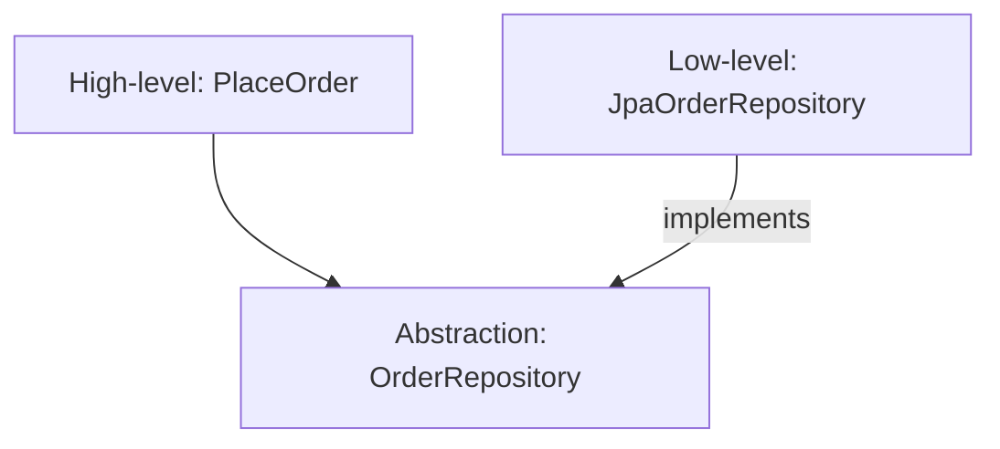

#SoftwareEngineering #BestPractices #ObjectOriented

Five object-oriented design principles collected by Robert C. Martin. They keep code easy to change:
- **S**ingle Responsibility: a class has one reason to change, i.e. answers to one actor. Not "does one thing"
- **O**pen/Closed: open for extension, closed for modification. Add behavior with new code (a new implementation) instead of editing a growing `when` / `switch`
- **L**iskov Substitution: a subtype must work everywhere its base type does, without surprises. A `Square` that breaks `Rectangle.setWidth` violates it
- **I**nterface Segregation: many small, client-specific interfaces instead of one large one. Clients don't depend on methods they don't use
- **D**ependency Inversion: high-level policy doesn't depend on low-level details. Both depend on abstractions, owned by the high-level side

```kotlin
// Dependency Inversion: the domain owns the interface, infrastructure implements it
interface OrderRepository { fun save(order: Order) }   // in the domain

class PlaceOrder(private val orders: OrderRepository) { /* ... */ }

class JpaOrderRepository : OrderRepository { /* ... */ } // in infrastructure
```

Where it shows up:
- Dependency Inversion is the core of [[Hexagonal Architecture]], [[Clean Architecture]] and every dependency injection note ([[Dependency Injection]], [[Spring Dependency Injection]], [[Koin]])
- Single Responsibility is behind "Massive View Controller" ([[MVC]]) and the split into [[MVVM]], [[VIPER]]
- Interface Segregation and Dependency Inversion make [[Test Doubles]] easy

**Pros**:
- changes stay local
- components are testable and replaceable
- shared vocabulary for design discussions

**Cons**:
- applied mechanically: an interface per class, tiny classes, lots of indirection ([[KISS]])
- Open/Closed for every possible extension violates [[YAGNI]]
- originally for class-based OO; in functional or component-based code (React, Compose) the ideas apply, the vocabulary less so



Arrows show the direction of dependencies. See [[Software Engineering Overview]].
