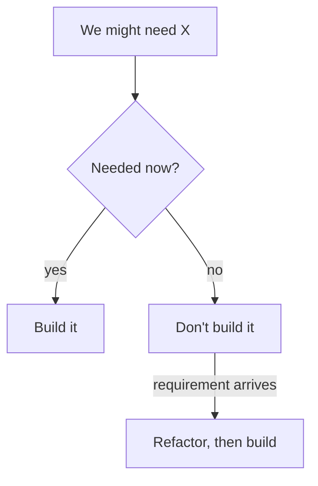

#SoftwareEngineering #BestPractices

**You Aren't Gonna Need It** (from [[Extreme Programming]], Ron Jeffries). Don't build a feature, abstraction or option until it's actually needed. Build for today's requirements, not for imagined future ones.

Typical violations:
- a plugin system or config flag "in case we need it"
- an interface with a single implementation and no test using a second one
- generic base classes for one subclass
- supporting several databases, languages or platforms nobody asked for
- splitting into [[Microservices]] for scale that doesn't exist yet

Costs of building it now (Martin Fowler):
- **cost of building**: time spent instead of on needed features
- **cost of delay**: needed features ship later
- **cost of carry**: more code to read, test and maintain
- **cost of repair**: when the real requirement arrives, it's usually different, and the speculative code has to be changed or removed

YAGNI applies to features and speculative flexibility, not to quality. Tests, readable code and error handling are needed now. YAGNI only works if code stays easy to change: [[Refactoring]] and good tests are the safety net.

**Pros**:
- less code, faster delivery
- no maintenance of unused flexibility
- design based on real requirements

**Cons**:
- some decisions are expensive to reverse (public APIs, data formats, security), these deserve thought up front
- without refactoring discipline, "add it later" turns into hacks
- can be used as an excuse to ignore known upcoming requirements

Closely related: [[KISS]]. See [[Software Engineering Overview]].
