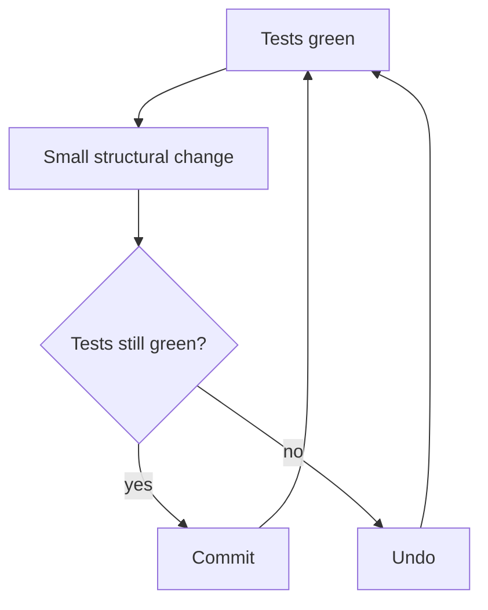

#SoftwareEngineering #BestPractices

Changing the **structure** of code without changing its **behavior** (Martin Fowler, *Refactoring*). Done in small, safe steps, each followed by running the tests.

Why: code decays as requirements change. Refactoring keeps it easy to change, which is what makes [[YAGNI]] and [[KISS]] safe: you don't need to build for the future if you can reshape the code when the future arrives.

When:
- **Preparatory**: before adding a feature, reshape the code so the feature is easy to add. "Make the change easy, then make the easy change" (Kent Beck)
- **Comprehension**: rename and extract while reading unclear code
- **Boy Scout rule**: leave the code a bit cleaner than you found it
- the "refactor" step of [[Test-Driven Development]]
- not as a separate months-long project ("the big rewrite"), but continuously

Common **code smells** and their refactorings:
- long method: extract method
- large class: extract class
- duplicated code: extract method or function ([[DRY]])
- long parameter list: introduce parameter object
- primitive obsession: replace primitive with value object ([[Object Calisthenics]])
- feature envy (a method uses another object's data more than its own): move method
- switch on type: replace conditional with polymorphism
- unclear names: rename

Rules:
- tests first: without tests, refactoring is just changing code and hoping
- small steps, commit often, each step keeps the tests green
- separate refactoring commits from behavior changes, reviews get easier
- let the IDE do mechanical refactorings (rename, extract, move), they're safe

**Pros**:
- code stays easy to change, development speed stays constant
- design improves based on real requirements, not guesses
- understanding grows while refactoring

**Cons**:
- needs a good test suite to be safe
- hard to justify to stakeholders when it's not visible ("technical debt" conversations)
- large refactorings across modules or APIs need planning (strangler fig, parallel change)

See [[Software Engineering Overview]].
