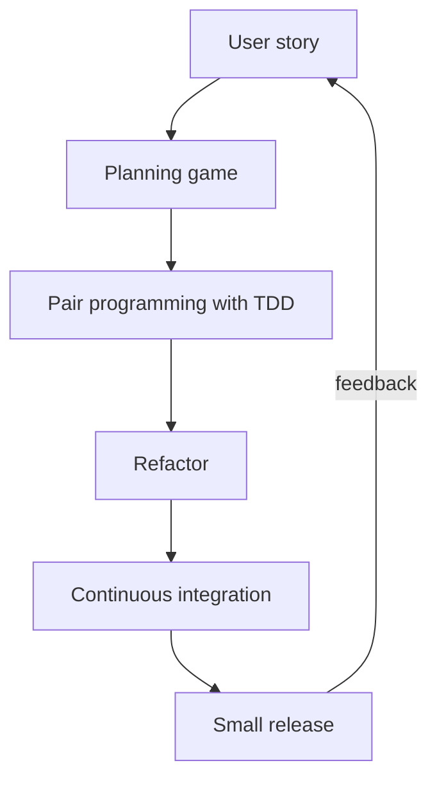

#SoftwareEngineering #BestPractices #Agile #Process

**XP** (Kent Beck, *Extreme Programming Explained*, 1999). An agile method that takes good engineering practices to the "extreme": if code review is good, review all the time (pair programming); if testing is good, test all the time (TDD); if integration is good, integrate many times a day (CI).

**Values**: communication, simplicity, feedback, courage, respect.

Practices:
- **Pair programming**: two developers, one keyboard. Continuous review and knowledge sharing. Mob (ensemble) programming extends it to the whole team
- **[[Test-Driven Development]]**: tests before code, plus customer-written acceptance tests
- **Continuous integration**: integrate and run all tests many times a day ([[Tests in CI]])
- **[[Refactoring]]**: continuously, as part of every change
- **Simple design**: Kent Beck's four rules, in priority order: passes the tests, reveals intention, no duplication, fewest elements ([[KISS]], [[DRY]], [[YAGNI]])
- **Small releases**: ship often, get real feedback early
- **Planning game**: customers prioritize user stories, developers estimate them. Short iterations (1-2 weeks)
- **Whole team / on-site customer**: someone who decides requirements is available all the time
- **Collective code ownership**: anyone may change any code
- **Coding standards**: one shared style, so collective ownership works
- **Sustainable pace**: no permanent overtime, tired teams write bugs

XP vs. Scrum: Scrum defines roles, events and artifacts for managing work, but no engineering practices. XP is mostly engineering practices. Many teams combine Scrum's process with XP's practices.

**Pros**:
- high code quality through constant feedback (tests, pairing, CI)
- knowledge spread across the team, no single point of failure
- adapts quickly to changing requirements
- many practices (TDD, CI, refactoring) became industry standard

**Cons**:
- demanding: pairing and TDD need practice and buy-in
- needs an available customer or product owner
- hard to scale to large organizations without extra structure
- practices depend on each other: picking only some (e.g. no tests, but collective ownership) breaks the safety net

See [[Software Engineering Overview]].
