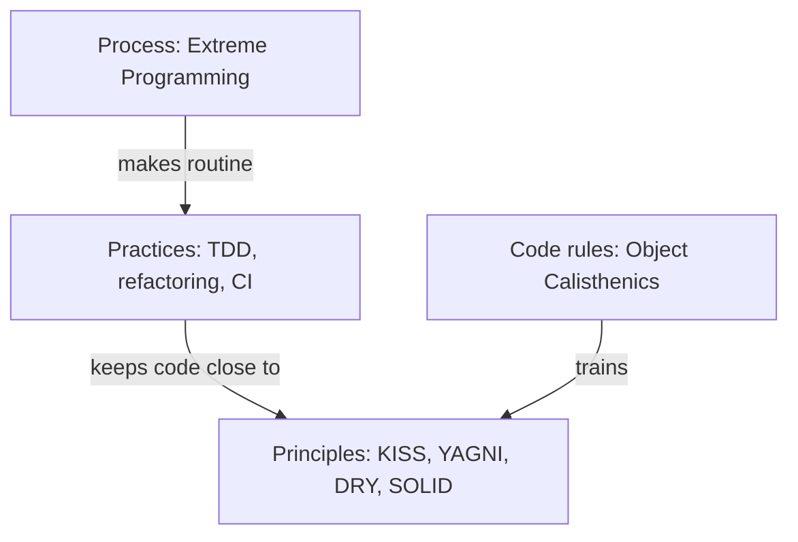

#SoftwareEngineering #BestPractices

How the levels fit together. Each level answers a different question. All of them are stack-neutral and apply to every section of this knowledge base.

| Level | Question | Options |
|---|---|---|
| Design principles | How should code be shaped? | [[KISS]], [[YAGNI]], [[DRY]], [[SOLID]] |
| Code rules | How do I train good habits in small code? | [[Object Calisthenics]] |
| Practices | How does code stay good over time? | [[Refactoring]], [[Test-Driven Development]], [[Testing Best Practices]], [[Tests in CI]] |
| Process | How does a team work so that all of this happens? | [[Extreme Programming]] |

They build on each other: a process like XP makes the practices routine (tests, refactoring, pairing). The practices keep the code close to the principles. Code rules like Object Calisthenics are an exercise to make the principles stick.

## Principles in tension
The principles pull in different directions. Judgement decides:
- **DRY vs. KISS**: removing duplication can add an abstraction that's harder to understand than the duplicate. Duplication is cheaper than the wrong abstraction
- **YAGNI vs. architecture**: don't build for imagined requirements, but keep the code easy to change ([[Refactoring]]) so you can when they arrive
- **SOLID vs. KISS**: an interface for every class is not "open/closed", it's noise. Add the seam when a second implementation or a test needs it

## Where it shows up in this knowledge base
- "simple first, more structure only when it pays off" in every architecture overview is [[KISS]] and [[YAGNI]]
- [[Dependency Injection]], [[Hexagonal Architecture]] and [[Clean Architecture]] apply the dependency inversion principle from [[SOLID]]
- the [[Domain Model]] puts behavior next to data, the core idea behind [[Object Calisthenics]]' "no getters and setters"
- [[Test-Driven Development]] and [[Tests in CI]] are XP practices

## How to apply
- principles are heuristics, not laws: know why each exists, then decide case by case
- optimize for the reader: code is read far more often than it's written
- make the change easy, then make the easy change (Kent Beck)
- agree on a few principles as a team and apply them consistently in reviews
