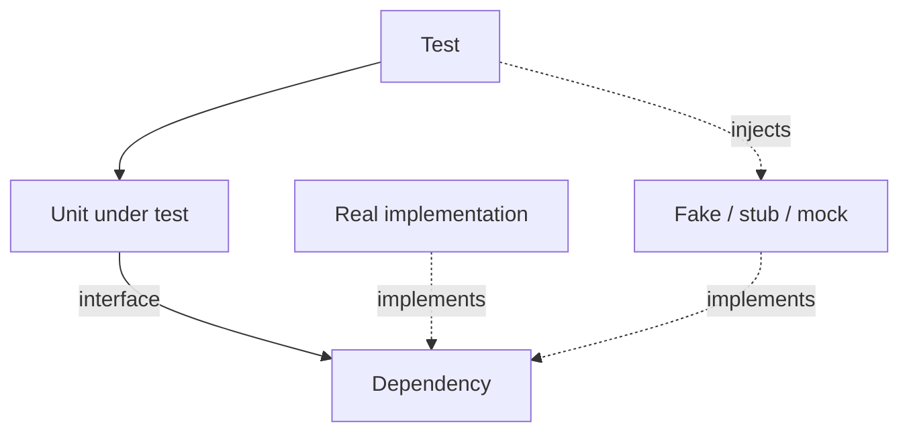

#Testing #Strategy

Objects that replace a real dependency in a test (Gerard Meszaros, *xUnit Test Patterns*). "Mock" is often used for all of them, but they differ:
- **Dummy**: passed only to fill a parameter, never used
- **Stub**: returns fixed answers (`getUser()` always returns Alice)
- **Spy**: a stub that also records how it was called, checked afterwards
- **Mock**: preconfigured with expected calls, fails if they don't happen. Verifies **interactions**
- **Fake**: a working, simplified implementation (in-memory repository, fake clock). Verifies **state**

```kotlin
class FakeOrderRepository : OrderRepository {
    private val orders = mutableMapOf<String, Order>()
    override suspend fun save(order: Order) { orders[order.id] = order }
    override suspend fun get(id: String) = orders[id]
}
```

Guidelines:
- **state over interaction**: assert on results, not on which methods were called. Interaction checks only where the call **is** the behavior (an email was sent, an event was published)
- **fakes over mocks** for dependencies you own: written once, reused everywhere, tests break less on refactoring
- **don't mock what you don't own**: wrap third-party APIs in your own interface and fake that. Test the wrapper with [[Integration Tests]]
- replace only what's slow, shared or non-deterministic: network, database, clock, random, file system
- too many doubles in one test is a design smell: the unit has too many dependencies

Doubles need a seam to be injected: that's what dependency injection provides.

**Pros**:
- fast, deterministic tests
- simulate errors and edge cases that are hard to produce for real (timeouts, server errors)
- test a unit before its dependencies exist

**Cons**:
- a double can drift from the real behavior, tests pass while production fails
- mock-heavy tests are coupled to implementation and break on refactoring
- fakes are code to maintain



## In our stacks
- **iOS**: protocols plus hand-written fakes, injected via initializers ([[Dependency Injection]]). TCA: `@Dependency` overrides in tests ([[TCA]])
- **Spring Boot**: Mockito (`mock`, `when`, `verify`), `@MockitoBean` inside a Spring context, in-memory fakes for repositories ([[Spring Dependency Injection]])
- **React Native**: `jest.fn()` and `jest.mock()`, MSW for HTTP instead of mocking the client, providers with fakes ([[React Context and Providers]])
- **Compose Multiplatform**: hand-written fakes in `commonTest` (Mockito / MockK don't run on Kotlin/Native), injected via constructors or a test [[Koin]] module

See [[Testing Overview]].
