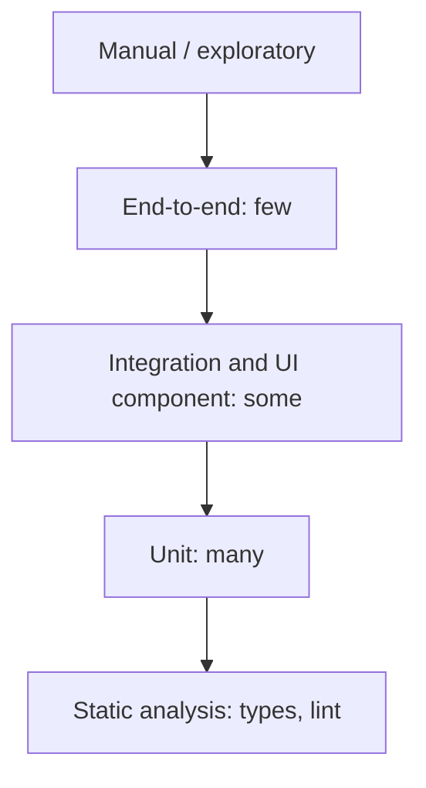

#Testing #Strategy

**Mike Cohn's test pyramid**: write many fast, cheap tests at the bottom and few slow, expensive tests at the top.
- **Base**: [[Unit Tests]]. Many, milliseconds each
- **Middle**: [[Integration Tests]] and [[UI Component Tests]]. Some
- **Top**: [[End-to-End Tests]]. Few, only critical journeys
- manual and exploratory testing on top, not as the main safety net

The shape is a guideline, not a ratio. The point: catch each bug at the **lowest** level that can catch it, because that's where it's fastest to find and fix.

Variants:
- **Testing trophy** (Kent C. Dodds): most effort on integration tests, with static analysis (types, linting) as the base. "Write tests. Not too many. Mostly integration." Popular in React / React Native, where component tests with mocked HTTP give the best value
- **Testing honeycomb** (Spotify): for [[Microservices]]. Mostly integration tests per service, few unit tests ("implementation detail tests") and few integrated tests across services. [[Contract Tests]] replace cross-service end-to-end tests

Anti-patterns:
- **Ice cream cone**: mostly manual and end-to-end tests, few unit tests. Slow, flaky, expensive
- **Hourglass**: many unit and end-to-end tests, nothing in between. Integration bugs only show up late

Read top to bottom: fewer tests, faster feedback, cheaper to run.

**Pros**:
- fast feedback overall, most tests run in seconds
- failures point to the cause
- stable suite, few flaky tests

**Cons**:
- a pure unit base with heavy mocking gives false confidence
- the right shape depends on the code: CRUD apps have little logic for unit tests
- counting tests per level says little about quality

## In our stacks
- **iOS**: pyramid. Logic in ViewModels, reducers and use cases makes most tests unit tests ([[iOS Architecture Overview]])
- **Spring Boot**: pyramid for domain-heavy services ([[Domain Model]]), trophy or honeycomb for CRUD services and [[Microservices]]: slice tests and Testcontainers carry most of the confidence
- **React Native**: trophy. TypeScript and ESLint as the base, most tests as component tests with React Native Testing Library and mocked HTTP
- **Compose Multiplatform**: pyramid. ViewModels and repositories in `commonTest`, Compose UI tests for key screens

See [[Testing Overview]].
