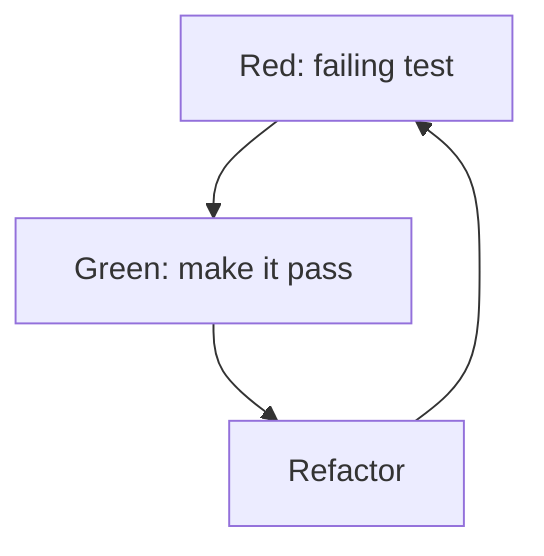

#Testing #Strategy #Process

**TDD** (Kent Beck): write the test **before** the code, in short cycles:
1. **Red**: write a small failing test for the next bit of behavior
2. **Green**: write the simplest code that makes it pass
3. **Refactor**: clean up code and tests while everything stays green

Each cycle takes minutes. The tests are a side effect, the main goal is design: code written to be testable ends up small, decoupled and with clear interfaces.

Styles:
- **Inside-out** (classicist): start with domain logic, build outward. Few mocks, design emerges from the core
- **Outside-in** (London / mockist): start with an acceptance test at the edge (API or UI), then drive each layer, mocking the layer below. Interfaces designed from the caller's view
- **BDD** (Behavior-Driven Development): TDD with a focus on behavior in business language, Given / When / Then. Sometimes as executable specifications (Cucumber, Gherkin) shared with non-developers

Where TDD pays off:
- business rules, calculations, parsers, state machines ([[Domain Model]], reducers)
- bug fixes: first a failing test that reproduces the bug
- code with clear inputs and outputs

Where it's harder:
- exploratory work and prototypes, when it's not yet clear what to build
- UI layout and visual design
- thin glue code around frameworks

**Pros**:
- every line of code is covered by a test that once failed
- testable design by construction
- small steps, always a working state to return to
- tests document intended behavior

**Cons**:
- feels slower at first, needs practice
- easy to over-specify with too many fine-grained mocks
- doesn't replace thinking about design, it supports it

## In our stacks
- **iOS**: Swift Testing with parameterized tests, ViewModels and reducers are natural TDD targets. TCA's `TestStore` fits the cycle well ([[TCA]])
- **Spring Boot**: domain and service logic with JUnit, outside-in from a `@WebMvcTest` or a Testcontainers test for new endpoints
- **React Native**: Jest watch mode for hooks, reducers and selectors ([[Redux Toolkit]], [[Custom Hooks]])
- **Compose Multiplatform**: ViewModels and repositories in `commonTest` with fakes, run on the JVM for speed

See [[Testing Overview]].
