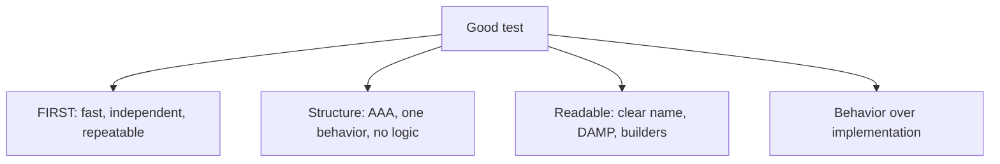

#Testing #BestPractices

What makes a good test, independent of type and stack. The details per test type live in each note, this is the collected list.

## FIRST
Good tests, especially [[Unit Tests]], are:
- **Fast**: the suite runs in seconds, so it runs all the time
- **Independent**: no shared state, no order dependence, can run alone or in parallel
- **Repeatable**: same result on every run and every machine. Inject clocks, randomness and dispatchers
- **Self-validating**: pass or fail through assertions, no manual checking
- **Timely**: written with the code or before it ([[Test-Driven Development]])

## Structure
- **Arrange, Act, Assert** (Given, When, Then): three visible blocks, one act per test
- **One behavior per test**: one reason to fail. Several assertions are fine if they check the same behavior
- **No logic in tests**: no loops, conditionals or calculations that could have their own bugs. Use parameterized tests for several inputs
- **Test through the public API**: not private methods, not internal state. If something private needs its own test, it probably wants to be its own unit

## Naming
The name states the behavior and the condition, so a failure reads like a bug report:
- `cancellingAPaidOrder_refundsThePayment`
- `should refund the payment when a paid order is cancelled`
- Swift Testing / Kotlin backticks allow plain sentences: `` `refunds the payment when a paid order is cancelled` ``

## Readability: DAMP over DRY
Production code follows [[DRY]], tests follow **DAMP** (Descriptive And Meaningful Phrases): a test should be understandable on its own, without jumping to shared setup.
- some duplication between tests is fine if it keeps each test readable
- hide irrelevant details, show what matters for this test
- **Test data builders**: `anOrder().paid().withTotal(100).build()` sets only the relevant fields, everything else gets valid defaults
- **Object mother**: named ready-made objects (`Orders.paidOrder()`). Simple, but tends to grow many variants, builders scale better
- avoid magic values, name them (`val expiredDate = today.minusDays(1)`)

## Behavior over implementation
- assert on results and visible state, not on which methods were called ([[Test Doubles]])
- a refactoring that keeps behavior must not break tests. If it does, the tests are coupled to implementation
- in UI tests, query like a user: text, roles, accessibility labels ([[UI Component Tests]])

## Coverage and maintenance
- **Every bug gets a test** that reproduces it before the fix
- **Beyoncé rule** (Google): "If you liked it, then you should have put a test on it." Anything that must not break needs a test, otherwise others may break it without knowing
- test where the risk is: business rules, money, data loss, critical journeys ([[Test Pyramid]])
- coverage is a signal, not a target. Mutation testing shows weak tests ([[Test Coverage]], [[Tests in CI]])
- flaky tests are bugs: quarantine, then fix or delete
- delete tests that no longer test anything meaningful
- test code is production code: same review and quality standards

## In our stacks
- **iOS**: Swift Testing for descriptive names (`@Test("refunds the payment ...")`) and parameterized tests (`arguments:`)
- **Spring Boot**: JUnit 5 `@DisplayName`, `@ParameterizedTest`, `@Nested` classes to group by condition, AssertJ for readable assertions
- **React Native**: Jest `describe` / `it` sentences, `it.each` for parameterized tests, factories (e.g. Fishery) as test data builders
- **Compose Multiplatform**: Kotlin backtick names, builder functions with default arguments as test data builders (`fun anOrder(status: Status = Status.DRAFT) = ...`)

See [[Testing Overview]].
