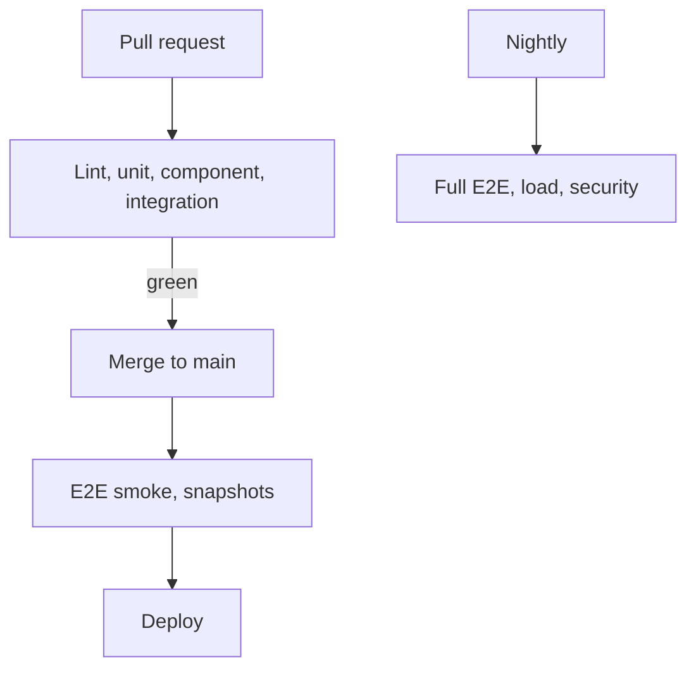

#Testing #Strategy #CI

Tests only protect the code if they run **automatically** on every change. Continuous integration (CI) runs them on every push or pull request and blocks merging when they fail.

Stages by speed:
- **Every commit / pull request** (minutes): lint, type checks, [[Unit Tests]], [[UI Component Tests]], most [[Integration Tests]], [[Contract Tests]]
- **Before merge or deploy**: broader integration tests, a smoke set of [[End-to-End Tests]], [[Snapshot Tests]]
- **Nightly or before release**: full end-to-end suite, device matrix, [[Non-functional Tests]] (load, security scans)
- **After deploy**: smoke tests against production, monitoring and alerts

Keeping it fast:
- parallelize test suites and shard across machines
- run only affected tests in monorepos (build tool caching, Gradle build cache, Turborepo / Nx)
- cache dependencies and build output
- a slow suite gets skipped by developers, keep the pull request pipeline under ~10 minutes

**Flaky tests** (pass or fail without code changes) destroy trust in the suite:
- track them, quarantine them out of the blocking path, then fix or delete
- common causes: timing (`sleep`), shared test data, order dependence, real network, animations
- don't add automatic retries as a permanent fix

**Coverage** is a signal, not a target (details in [[Test Coverage]], gates in [[Static Analysis and Quality Gates]]):
- low coverage shows untested areas
- high coverage doesn't prove good tests: tests without meaningful assertions also count
- **mutation testing** measures test quality: the tool changes the code (flips a condition, removes a call) and checks that some test fails. Surviving mutants show weak tests

**Pros**:
- bugs found minutes after they're introduced
- the main branch stays releasable
- consistent environment, no "works on my machine"

**Cons**:
- pipelines need maintenance and cost compute (macOS runners for iOS are expensive)
- flaky or slow suites block everyone
- coverage targets invite meaningless tests

## In our stacks
- **iOS**: `xcodebuild test` or Fastlane on macOS runners (GitHub Actions, Xcode Cloud, Bitrise), test plans to split fast and slow suites
- **Spring Boot**: Maven / Gradle with Testcontainers in CI (needs Docker), JaCoCo for coverage, PIT for mutation testing
- **React Native**: Jest in Node (no device needed), Maestro Cloud or EAS Workflows for end-to-end flows on devices ([[Expo]]), Stryker for mutation testing
- **Compose Multiplatform**: `./gradlew allTests` runs `commonTest` on every target, iOS tests need macOS runners, Kover for coverage

See [[Testing Overview]].
