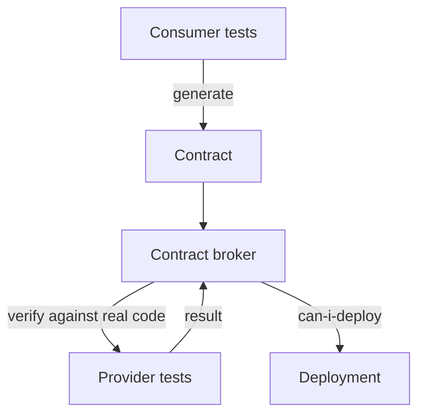

#Testing #API

Check that two sides of an API agree, **without** running them together. Each side is tested on its own against a shared **contract**: the requests the consumer sends and the responses it expects.

**Consumer-driven contracts**:
1. the **consumer** (app, other service) writes tests against a mock provider. These generate the contract
2. the contract is shared, usually through a broker (Pact Broker / PactFlow)
3. the **provider** (API) replays every consumer's contract against its real code in its own pipeline
4. a breaking change fails the provider's build before deployment. `can-i-deploy` checks which versions are compatible

Alternative: **provider-driven** contracts from an OpenAPI spec, checked on both sides (schema validation, generated clients).

Contracts check structure and meaning of messages (fields, types, status codes), not business logic. That stays in the provider's own tests.

**Pros**:
- replaces most cross-service [[End-to-End Tests]]
- each side tests independently, fast and in its own pipeline
- the provider knows exactly which fields consumers really use

**Cons**:
- setup and a broker to run
- needs discipline on both teams
- doesn't catch problems in the actual deployment or network

## In our stacks
- **Spring Boot**: Pact JVM for provider verification, or Spring Cloud Contract (provider-driven, generates stubs for consumers). Essential with [[Microservices]]
- **React Native**: Pact JS consumer tests for the API client, or a generated client from OpenAPI
- **iOS**: PactSwift (community library) for consumer tests. Many teams instead use a generated OpenAPI client plus schema checks in the backend pipeline
- **Compose Multiplatform**: Pact JVM works in Android/JVM tests, not in `commonTest`. A generated OpenAPI client plus kotlinx.serialization tests against recorded responses is the common alternative

See [[Testing Overview]].
