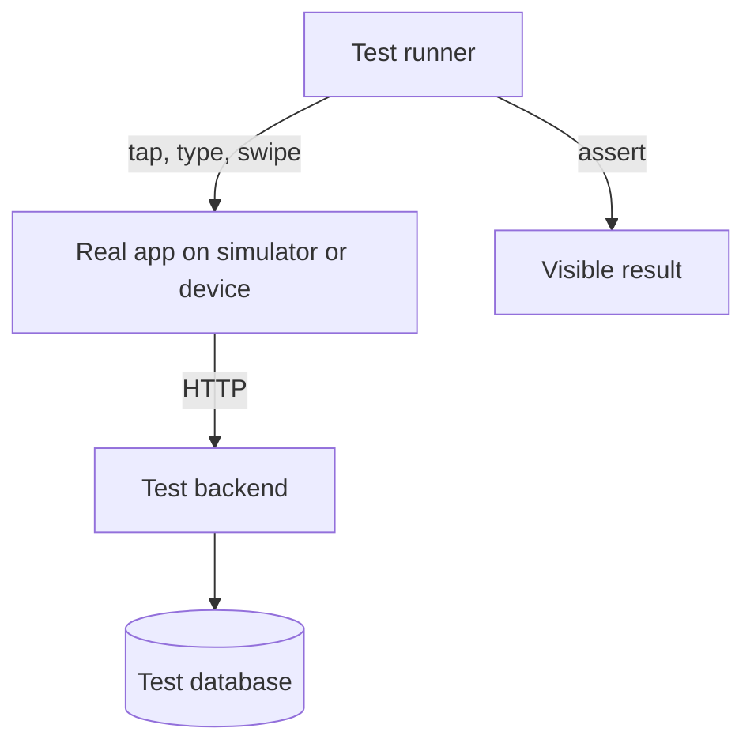

#Testing

Test the **whole system** the way a user uses it: the real app on a device or the real API, with a real (test) backend and database. The highest confidence that a journey works, at the highest cost.

What to cover: a handful of **critical user journeys**: sign up, log in, the main purchase or booking flow, payment. Everything else is cheaper to test lower in the [[Test Pyramid]].

Practices:
- each test creates its own data (via API or seed scripts), never relies on leftovers from other tests
- wait for conditions, never for fixed time (`sleep`)
- stable selectors: accessibility labels or test IDs, not layout positions
- run against a dedicated test environment, ideally recreated per run
- treat flaky tests as bugs: fix or delete them ([[Tests in CI]])

**Pros**:
- the only test type that proves the whole system works together
- catch integration and configuration problems between apps, backend and infrastructure
- readable as user stories, useful as acceptance tests

**Cons**:
- slow: minutes per test
- flaky: network, timing, animations, test data
- a failure says something is broken, not what
- expensive to maintain when the UI changes

## In our stacks
- **iOS**: XCUITest, launched with arguments that select a test backend or seed data
- **React Native**: Maestro (YAML flows, iOS and Android, no code changes) or Detox (gray-box, waits for the app to be idle)
- **Compose Multiplatform**: Maestro across platforms, or the native tools per platform (Espresso / Compose test on Android, XCUITest on iOS)
- **Spring Boot**: API-level end-to-end tests with REST Assured against a deployed environment. Across services, prefer [[Contract Tests]] ([[Microservices]])

See [[Testing Overview]].
