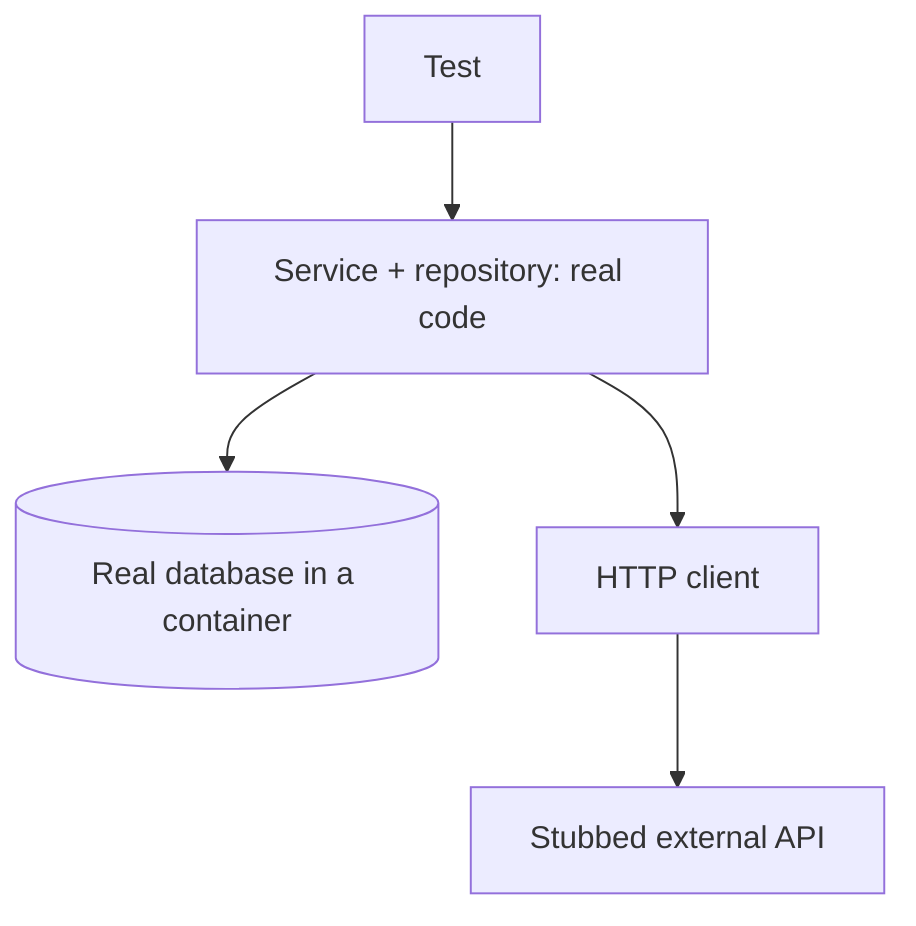

#Testing

Test several real parts **together**, including real infrastructure: a database, an HTTP layer, the framework's configuration, a message broker. They catch what unit tests can't: wrong SQL, broken mappings, misconfigured serialization, missing transactions.

Two kinds:
- **Narrow integration tests**: one adapter against the real dependency. A repository against a real database, an API client against a stubbed HTTP server. Fast enough to run often
- **Broad integration tests**: many modules or the whole application, started in-process. Higher confidence, slower, harder to debug

Practices:
- use the **real** database engine (in a container), not an in-memory substitute with different SQL behavior
- each test sets up its own data and cleans up (transactions rolled back, fresh schema), so tests don't depend on each other
- stub external systems you don't own at the HTTP level (WireMock, MSW, `MockEngine`), check the real API with [[Contract Tests]]
- keep the number of broad tests small, push detail down to narrow tests and [[Unit Tests]]

**Pros**:
- catch configuration, mapping and query bugs
- test the code the way it runs in production
- fewer mocks, so less coupling to implementation

**Cons**:
- slower than unit tests (seconds instead of milliseconds)
- need infrastructure (Docker, emulators)
- failures are harder to locate
- shared state between tests causes flakiness

## In our stacks
- **Spring Boot**: slice tests start part of the context: `@DataJpaTest` (repositories), `@WebMvcTest` (controllers), `@JsonTest`. `@SpringBootTest` starts everything. Testcontainers for PostgreSQL, Kafka etc., wired with `@ServiceConnection`. WireMock for external APIs ([[Spring Data]], [[Transactions]])
- **iOS**: networking code against a stub `URLProtocol`, persistence against a temporary or in-memory store (SwiftData `ModelConfiguration(isStoredInMemoryOnly:)`)
- **React Native**: hooks rendered with a real `QueryClient` and MSW intercepting HTTP, store with real reducers ([[TanStack Query]], [[Redux Toolkit]])
- **Compose Multiplatform**: repositories with Ktor `MockEngine` and an in-memory Room or SQLDelight database ([[Multiplatform Data Layer]])

See [[Testing Overview]].
