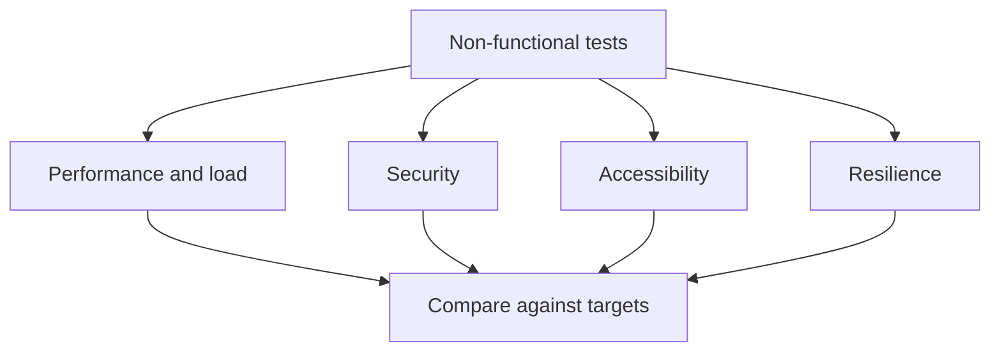

#Testing

Test **how well** the system works instead of **what** it does. Usually run less often than functional tests: nightly, before releases, or continuously in production.
- **Performance tests**: response times and resource usage under normal load. Includes app startup time, frame rate, memory
- **Load tests**: behavior under expected peak load
- **Stress and spike tests**: beyond the limits, to find where and how it breaks
- **Soak tests**: normal load over hours, to find memory leaks and resource exhaustion
- **Security tests**: dependency scanning, static analysis (SAST), dynamic scanning against a running app (DAST), penetration tests
- **Accessibility tests**: screen reader labels, contrast, touch target sizes, dynamic type. Automated checks plus manual testing with VoiceOver / TalkBack
- **Resilience tests** (chaos engineering): kill instances, add latency, check the system recovers

Practices:
- define targets first (e.g. 95th percentile under 300 ms at 500 requests per second), otherwise results can't fail
- test in an environment close to production in size and data
- automate the cheap checks (dependency scans, accessibility linting) on every pull request, run the expensive ones on a schedule
- monitor production as well: real user metrics catch what tests miss

**Pros**:
- find problems that only show at scale or over time
- security and accessibility problems found before users or attackers do
- give data for capacity planning

**Cons**:
- need realistic environments and data, expensive to run
- results vary between runs, hard to make pass / fail
- easy to postpone until it's too late

## In our stacks
- **Spring Boot**: Gatling or k6 for load tests, Micrometer metrics to see where time goes, OWASP Dependency-Check or Snyk for dependencies, OWASP ZAP for dynamic scans
- **iOS**: Instruments (Time Profiler, Allocations, Leaks), XCTest performance metrics (`measure`), Xcode's accessibility audit (`performAccessibilityAudit` in UI tests)
- **React Native**: Flashlight or React Native DevTools profiler for frame rate and JS thread load, eslint-plugin-react-native-a11y, `npm audit`
- **Compose Multiplatform**: Macrobenchmark and Baseline Profiles on Android, Instruments on iOS, Compose semantics for accessibility

See [[Testing Overview]].
