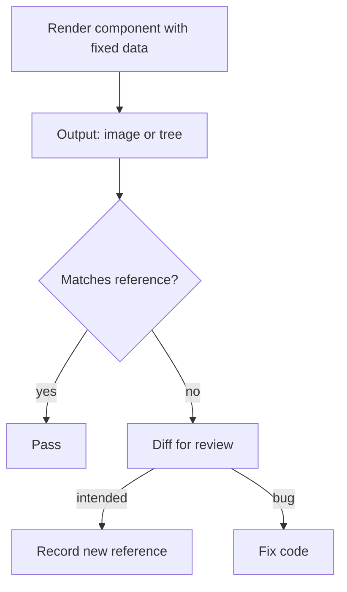

#Testing #UI

Render something, compare the output with a stored **reference** (snapshot). The test fails when the output changes. Reviewing the diff decides: bug, or new reference.

Two kinds:
- **Screenshot tests**: compare images pixel by pixel (with tolerance). Catch visual regressions: layout, colors, fonts, dark mode, dynamic type, localization
- **Tree snapshots**: compare a serialized component tree or text output. Cheap, but say little about how it looks

Practices:
- snapshot stateless components with fixed data, in the relevant variants (light / dark, font sizes, languages, devices)
- generate references on a fixed environment (same OS, simulator, renderer), otherwise pixels differ between machines
- review snapshot diffs in pull requests like code, don't re-record blindly
- small, focused snapshots instead of whole screens with dynamic content

**Pros**:
- catch visual regressions nobody writes assertions for
- cover many variants (themes, sizes, languages) cheaply
- the reference images document the UI

**Cons**:
- brittle: any intended change means re-recording
- easy to accept wrong output by re-recording without looking
- environment differences cause false failures
- say nothing about behavior, combine with [[UI Component Tests]]

## In our stacks
- **iOS**: swift-snapshot-testing (Point-Free), images of SwiftUI views and UIKit view controllers across devices and traits
- **React Native**: Jest tree snapshots (`toMatchSnapshot`) are cheap but low value and often re-recorded blindly, use sparingly. Visual screenshots need a device or emulator based tool
- **Compose Multiplatform**: Roborazzi (Robolectric, also multiplatform setups) or Paparazzi (Android, no emulator). Compose previews can be turned into screenshot tests
- **Spring Boot**: approval testing of JSON responses (e.g. ApprovalTests), useful for large API payloads

See [[Testing Overview]].
