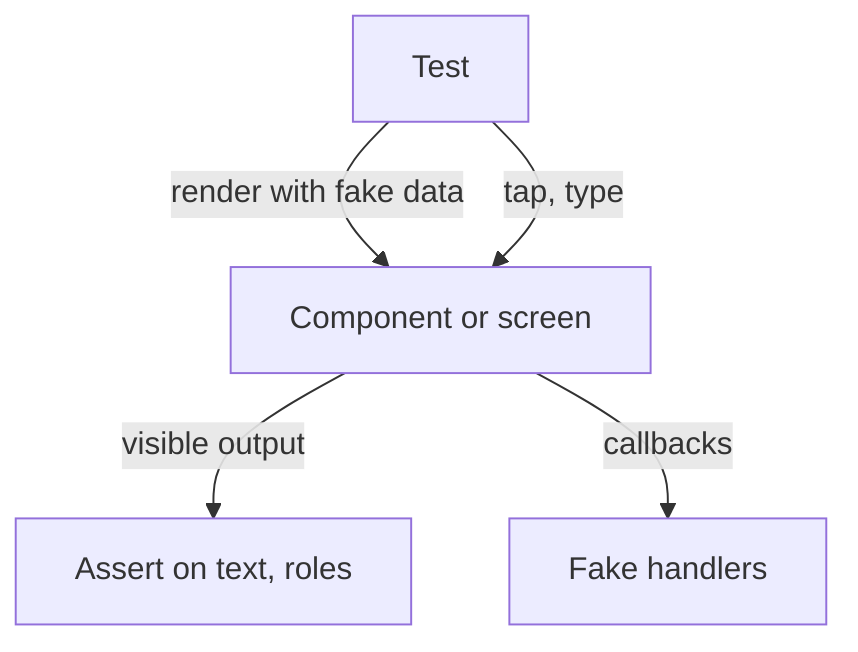

#Testing #UI

Render **one** screen or component with fake data, interact with it like a user, and assert on what is visible. No real backend, no app navigation. Sits between [[Unit Tests]] and [[End-to-End Tests]].

Practices:
- query elements the way a user or screen reader finds them: by text, role or accessibility label. Test IDs only as a fallback
- assert on visible output ("Order cancelled" is shown), not on internal state
- feed data through the component's inputs or fake dependencies ([[Test Doubles]])
- stateless components are the easiest to test, see [[Container and Presentational Components]], [[Compose State and Hoisting]], [[View Composition]]

```tsx
test('cancelling an order shows a confirmation', async () => {
  const user = userEvent.setup();
  render(<OrderDetail order={order} onCancel={onCancel} />);

  await user.press(screen.getByRole('button', { name: 'Cancel order' }));

  expect(onCancel).toHaveBeenCalledWith(order.id);
});
```

**Pros**:
- test what the user experiences without the cost of end-to-end tests
- fast enough to run on every pull request (on the JVM or in Node, no device needed in most stacks)
- accessible queries also improve accessibility

**Cons**:
- the test environment differs from a real device (no real layout, animations or gestures in some stacks)
- tightly coupled tests break on every UI change
- easy to retest logic that unit tests already cover



## In our stacks
- **iOS**: SwiftUI has no official component test API. Options: ViewInspector (third party), snapshot tests ([[Snapshot Tests]]), or XCUITest launched straight into one screen with stubbed data
- **React Native**: React Native Testing Library with Jest, queries by role and text, `userEvent` for interactions
- **Compose Multiplatform**: `runComposeUiTest` in `commonTest`, finders like `onNodeWithText`, `performClick()`. On Android also `createComposeRule`
- **Spring Boot**: the API is the UI: `@WebMvcTest` with `MockMvc` tests a controller's HTTP contract, validation and error mapping ([[Spring MVC]])

See [[Testing Overview]].
