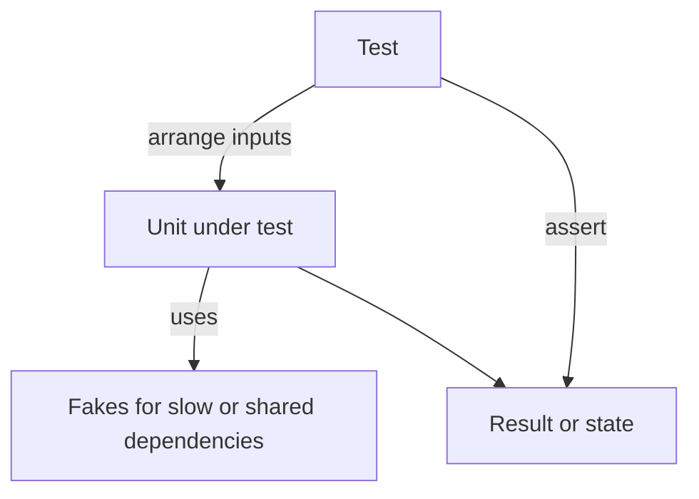

#Testing

Test one **unit** in isolation, in memory, in milliseconds. No network, database, file system or UI.

What counts as a unit is debated:
- **Mockist ("London") school**: a unit is one class. All its collaborators are replaced by [[Test Doubles]]
- **Classicist ("Detroit") school**: a unit is one **behavior**. Real collaborators are fine as long as the test stays fast and in memory. Only shared or slow dependencies (database, network, clock) are replaced
- the classicist style breaks less on refactoring, the mockist style pinpoints failures more precisely

Structure every test as **Arrange, Act, Assert** (or Given, When, Then):

```kotlin
@Test
fun `placing an order without lines fails`() {
    val order = Order(lines = emptyList())          // arrange

    val result = runCatching { order.place() }      // act

    assertTrue(result.isFailure)                    // assert
}
```

A good unit test follows **FIRST** (from Robert C. Martin's *Clean Code*):
- **Fast**: milliseconds each, the whole suite runs in seconds. Slow tests stop being run
- **Independent** (Isolated): no shared state, no order dependence. Each test sets up its own data and can run alone or in parallel
- **Repeatable**: same result every run, on every machine and in CI. Inject clocks, random numbers and dispatchers, no real network or database
- **Self-validating**: passes or fails on its own through assertions. No reading logs or comparing output by hand
- **Timely**: written together with the code, or before it ([[Test-Driven Development]]), not weeks later when the code is hard to test

Beyond FIRST:
- **behavior-focused**: asserts on outputs and state, not on which private methods were called
- **readable**: the name says what behavior is expected

What to unit test: business rules ([[Domain Model]]), ViewModels and reducers, mappers, validation, calculations. Not worth it: trivial getters, framework glue, code that only delegates.

**Pros**:
- fastest feedback, run on every save
- pinpoint exactly what broke
- force a testable design (small units, injected dependencies)

**Cons**:
- don't prove the parts work together ([[Integration Tests]])
- heavy mocking couples tests to implementation details
- high unit coverage can hide missing higher-level tests



## In our stacks
- **iOS**: Swift Testing (`@Test`, `#expect`) or XCTest. ViewModels ([[MVVM]]) tested directly, TCA reducers with `TestStore` ([[TCA]])
- **Spring Boot**: JUnit 5, AssertJ, Mockito. Plain constructor calls, no Spring context ([[Spring Dependency Injection]])
- **React Native**: Jest. Hooks via `renderHook` ([[Custom Hooks]]), Redux reducers and selectors as plain functions ([[Redux Toolkit]])
- **Compose Multiplatform**: `kotlin.test` in `commonTest`, runs on every platform. `kotlinx-coroutines-test` (`runTest`) and Turbine for Flows ([[Multiplatform ViewModel]])

See [[Testing Overview]].
