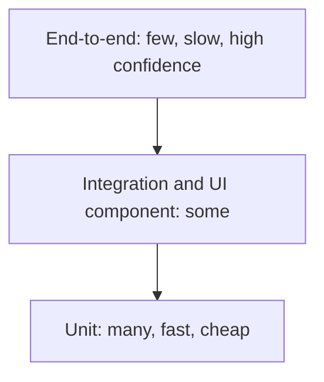

#Testing #Architecture

How the parts of a testing strategy fit together. Each level answers a different question. The concepts are stack-neutral, each note ends with how it looks in our stacks.

| Level | Question | Options |
|---|---|---|
| Test types | What does a test cover? | [[Unit Tests]], [[Integration Tests]], [[UI Component Tests]], [[End-to-End Tests]] |
| Specialized types | What else needs checking? | [[Contract Tests]], [[Snapshot Tests]], [[Non-functional Tests]] |
| Practices | What makes a good test? | [[Testing Best Practices]] (FIRST, AAA, DAMP, ...) |
| Strategy | How many of each? | [[Test Pyramid]], testing trophy, honeycomb |
| Isolation | How are dependencies replaced? | [[Test Doubles]] |
| Process | When are tests written? | [[Test-Driven Development]] |
| Automation | Where and how often do tests run? | [[Tests in CI]] |

The types differ in **scope**: the more real parts a test uses, the more confidence it gives, but the slower, more expensive and flakier it gets.

Read from top to bottom: fewer tests, more speed. See [[Test Pyramid]].

Architecture makes testing possible: [[Dependency Injection]] and clear boundaries ([[Hexagonal Architecture]], [[Clean Architecture]]) let most logic be tested without UI, network or database.

## Typical setup per stack
- **iOS**: many unit tests on ViewModels, reducers and use cases (Swift Testing), snapshot tests for key screens, a few XCUITest journeys
- **Spring Boot**: unit tests for domain and services, slice tests (`@WebMvcTest`, `@DataJpaTest`), integration tests with Testcontainers, contract tests between services
- **React Native**: Jest for hooks and logic, React Native Testing Library for screens with mocked APIs (MSW), a few Maestro flows
- **Compose Multiplatform**: unit tests for ViewModels and repositories in `commonTest`, Compose UI tests, screenshot tests, a few Maestro flows

## How to choose
- test behavior, not implementation: a refactoring shouldn't break tests
- spend effort where the risk is: business rules, money, data loss, critical user journeys
- fast feedback first: most tests should run in seconds, locally and on every pull request
- every bug gets a test that reproduces it
- automated tests don't replace exploratory testing by a human
- simple first, more test types only when they catch real bugs
