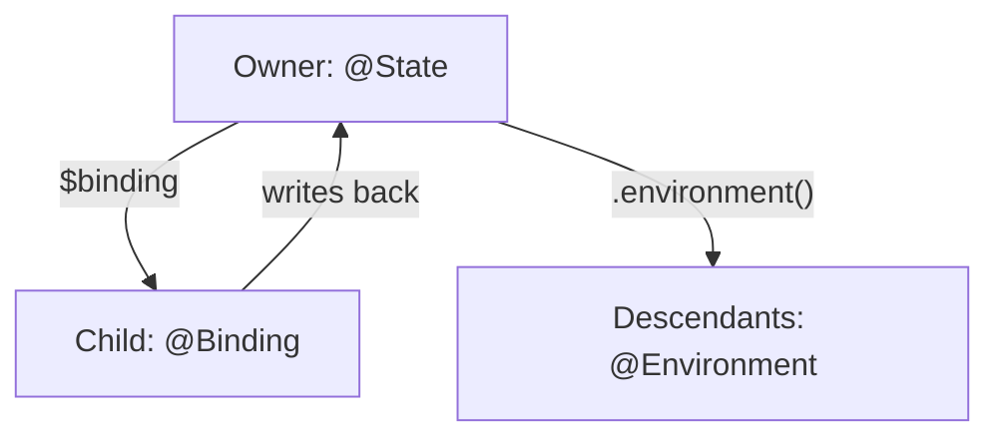

#SwiftUI #StateManagement

The core SwiftUI skill: who **owns** a piece of state. The view is a function of state and updates automatically when it changes.
- `@State`: local state owned by the view (also holds an `@Observable` object the view creates)
- `@Binding`: a reference to state owned by a parent view, for writing back
- `@Observable` (iOS 17+): a class whose properties views observe automatically
- `@Bindable`: creates bindings to properties of an `@Observable` object
- `@Environment`: shared state or dependencies passed down the view tree

Principle: **one owner per piece of state**, pass it down, don't duplicate it.

```swift
@Observable final class Cart { var items: [Item] = [] }

struct ShopView: View {
    @State private var cart = Cart()          // owner
    @State private var showCart = false       // local UI state
    var body: some View {
        ProductList()
            .environment(cart)                // shared down the tree
            .sheet(isPresented: $showCart) { CartView(isPresented: $showCart) }
    }
}

struct CartView: View {
    @Environment(Cart.self) private var cart
    @Binding var isPresented: Bool            // owned by ShopView
    var body: some View { /* ... */ }
}
```



Related: [[MV]], [[MVVM]], [[TCA]]
