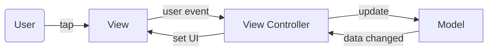

#Architecture #UIArchitecture

Apple's classic pattern in UIKit:
- **M**odel: the data and business rules
- **V**iew: the UI elements
- **C**ontroller: the `UIViewController`. It connects the two, reacts to user input and updates the view

**Pros**:
- simple and fast to start
- no extra abstration
- it's what Apple's UIKit documentation uses

**Cons**:
- the view controller tends to accumulate logic, networking, navigation and formatting
- "Massive View Controller" hard to unit-test because logic is tied to UIKit
- Not 

